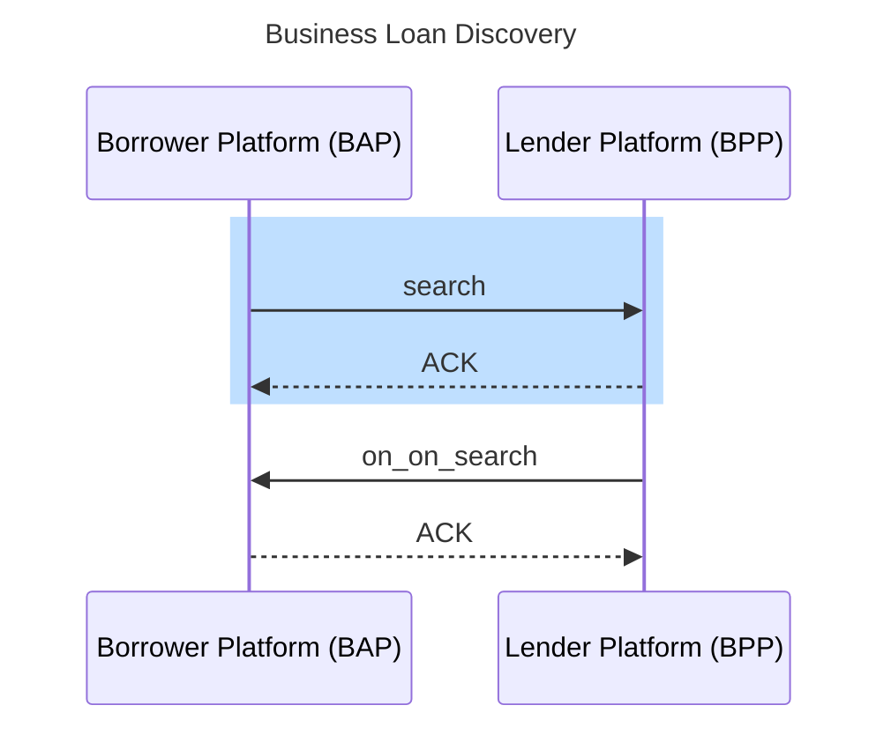
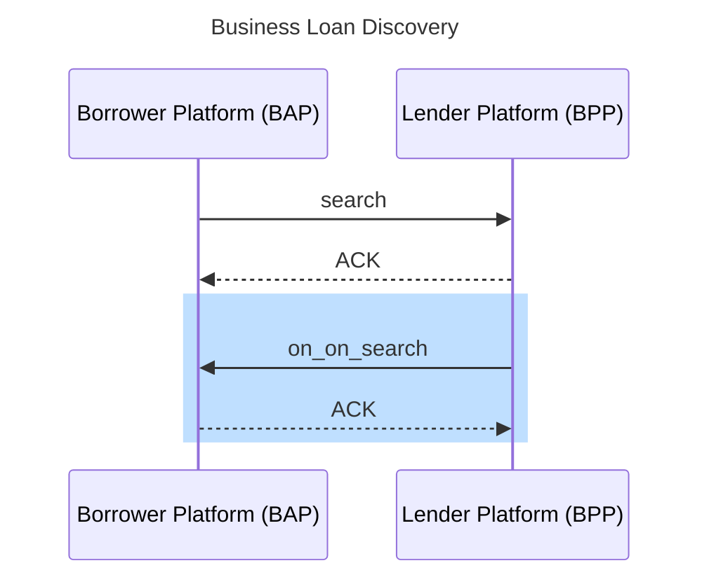
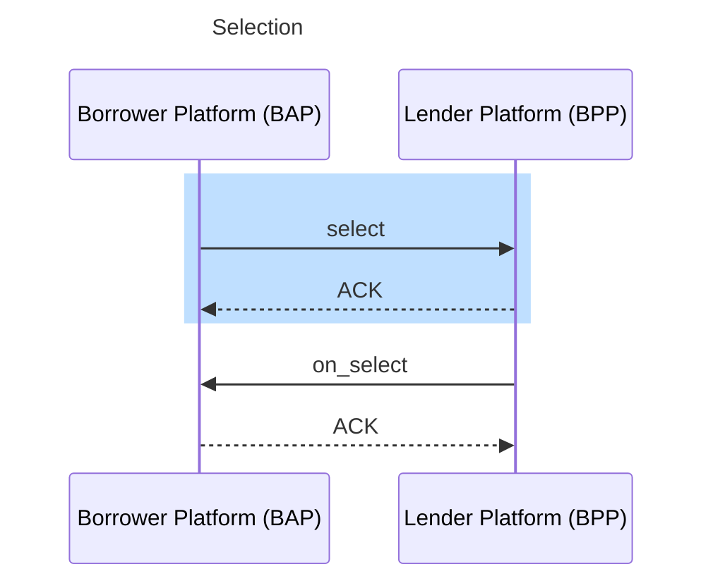
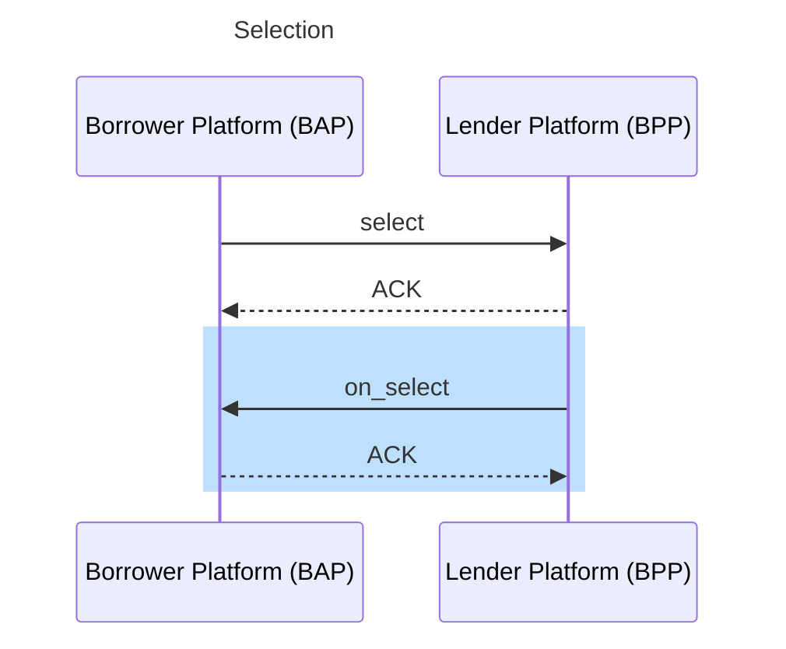
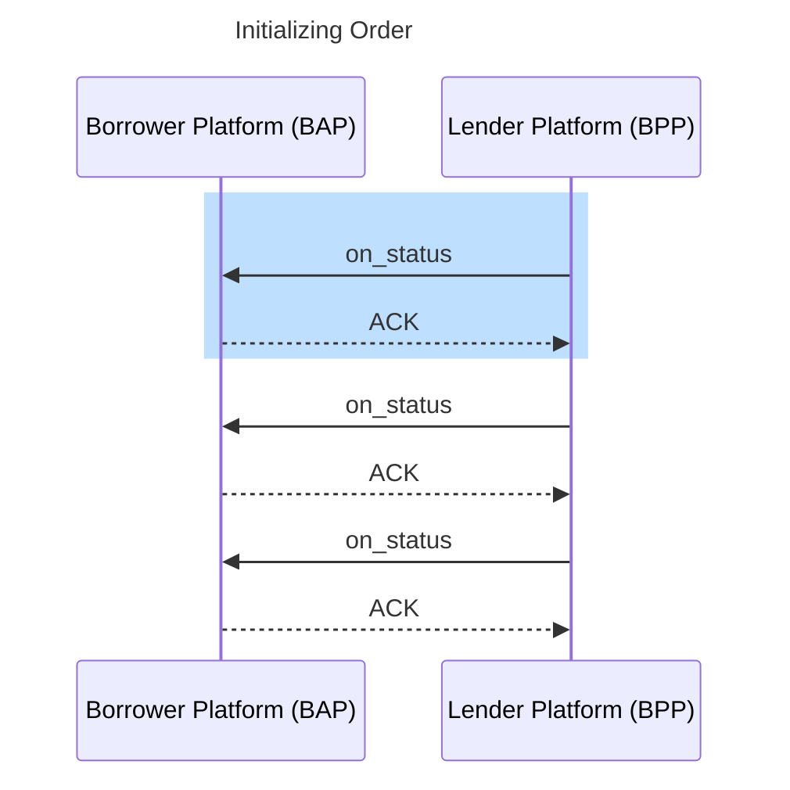
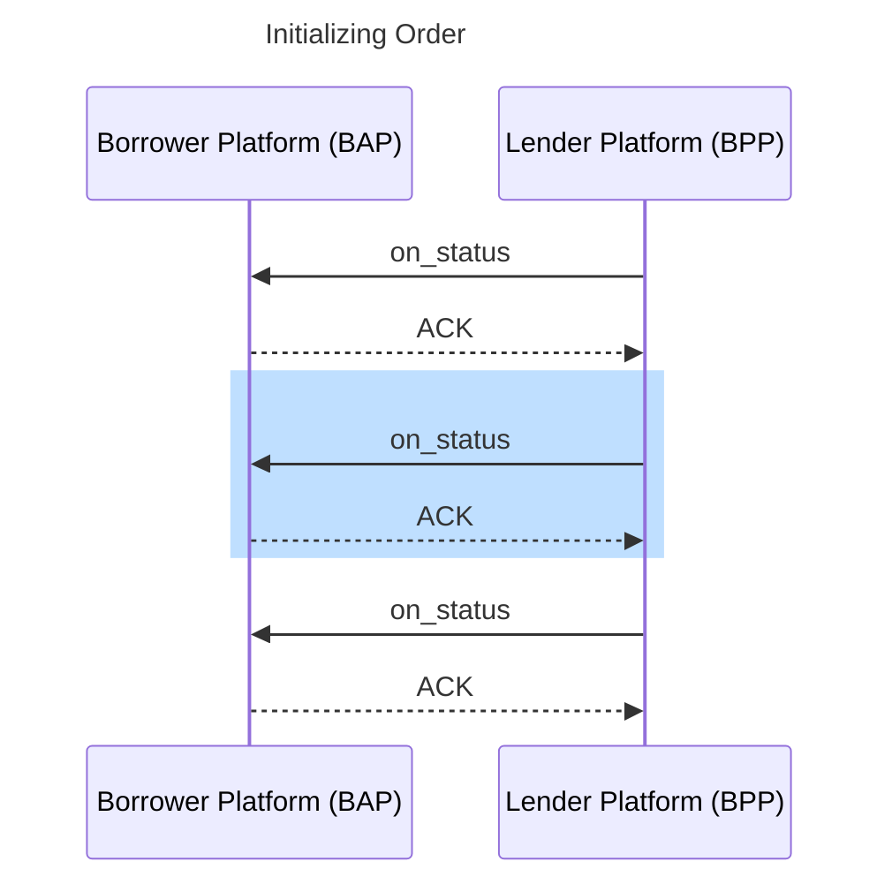
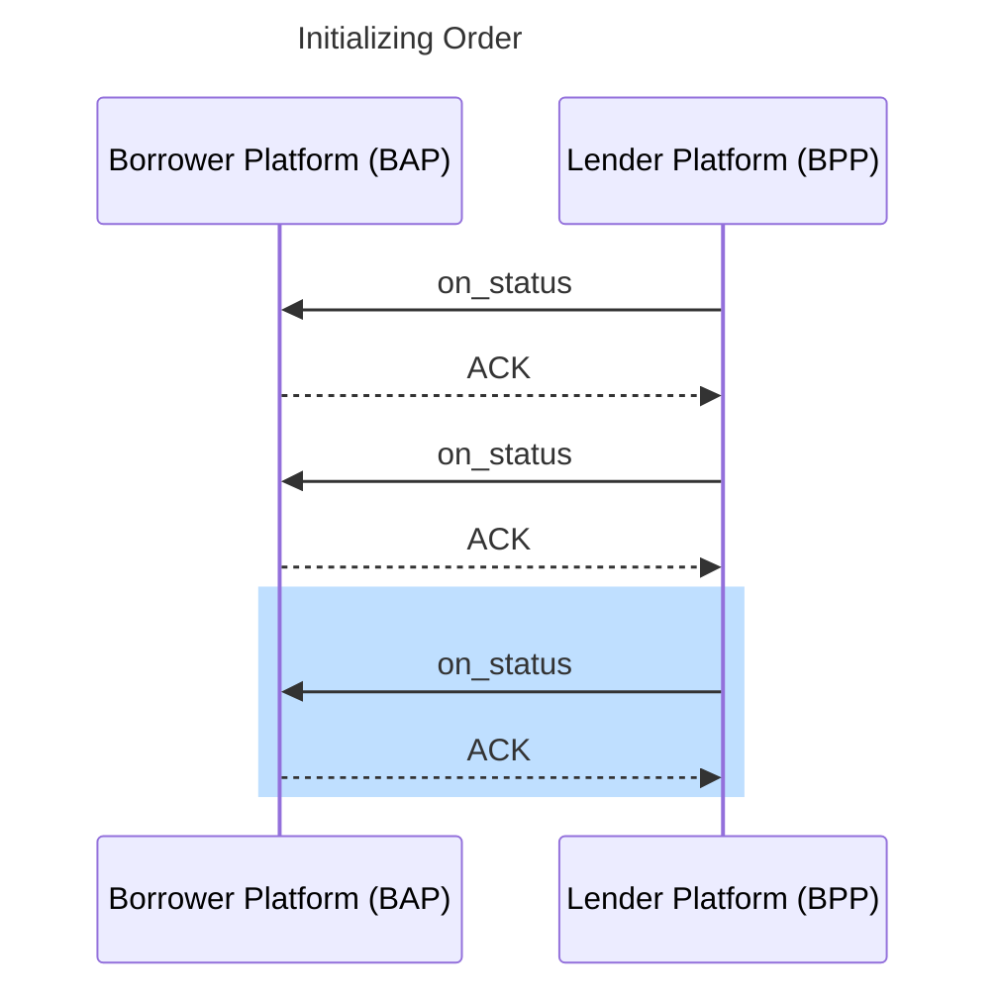
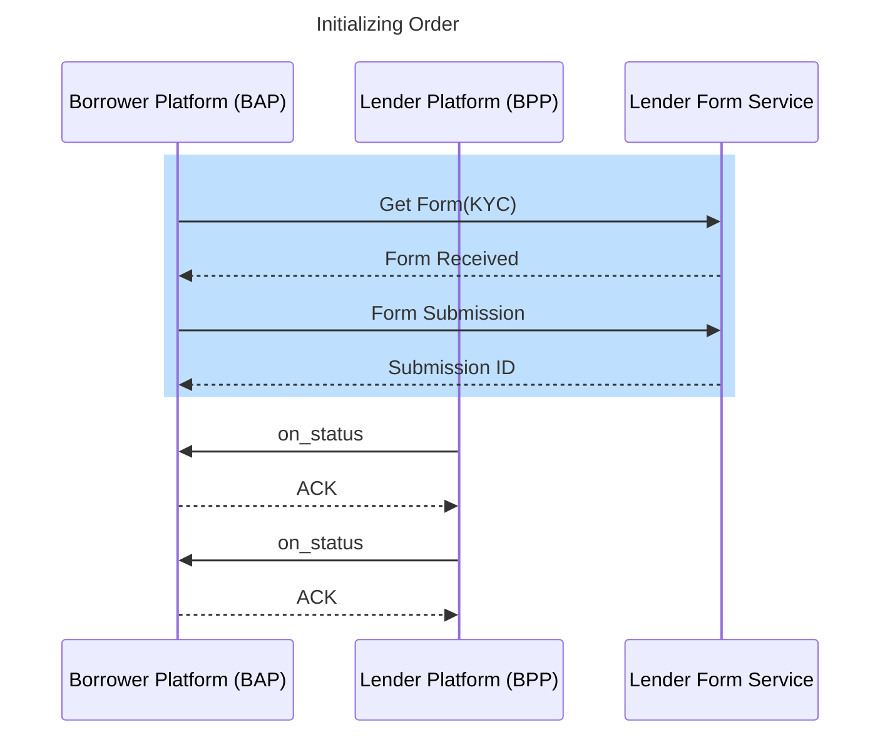
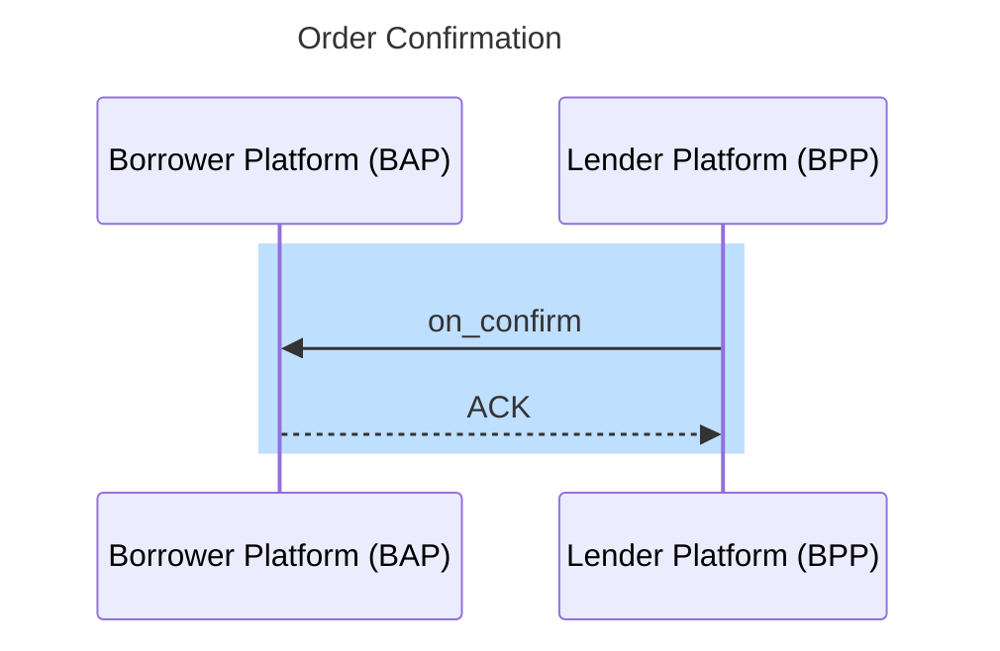

# business term loan without aa — Sequence Diagrams

Internal data file consumed by the Developer Guide's "Sequence Diagram" tab (API Walkthrough).
Not meant to be shown as its own docs page — the frontend filters this slug out of the Use Case
Brief / Additional Resources / Changelog tab lists and instead looks up the section matching the
selected API call's `action_id` (the `##` heading below) to render that step's diagram.

One `## <action_id>` heading per step of `business_term_loan_without_aa.yaml`, in that flow's own step order, each
followed by its Mermaid `sequenceDiagram`.

## search_1

## on_search_1

## select_1

## on_select_1

## on_status_1

## on_status_2

## on_status_3

## single_redirection

## select_2

## on_select_2

## on_confirm_1

