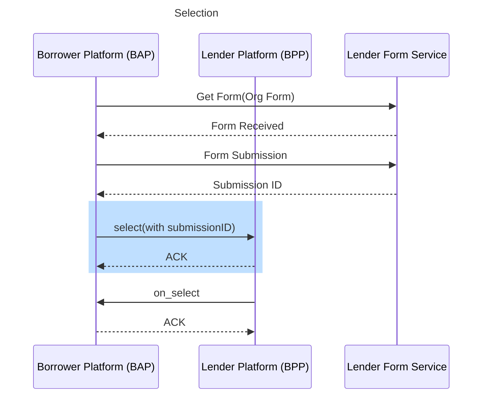
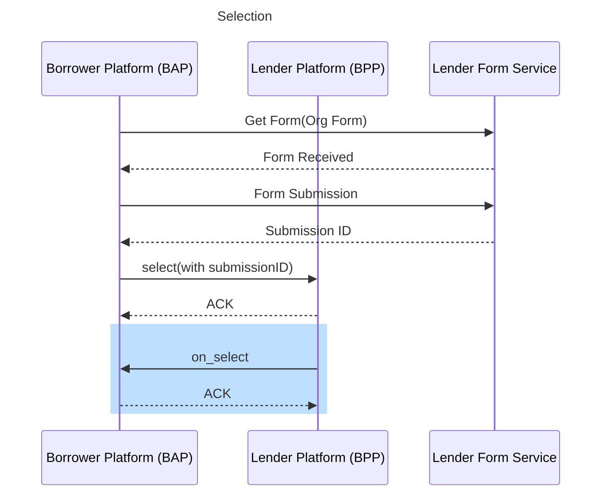

# dedupe check — Sequence Diagrams

Internal data file consumed by the Developer Guide's "Sequence Diagram" tab (API Walkthrough).
Not meant to be shown as its own docs page — the frontend filters this slug out of the Use Case
Brief / Additional Resources / Changelog tab lists and instead looks up the section matching the
selected API call's `action_id` (the `##` heading below) to render that step's diagram.

One `## <action_id>` heading per step of `dedupe_check.yaml`, in that flow's own step order, each
followed by its Mermaid `sequenceDiagram`.

No Business Loan source exists for this dedupe-check step pair; reuses the Personal Loan dedupe-check's select/on_select diagrams per explicit instruction.

## select_1

## on_select_1

