# Flow Diagrams (ONDC:RET10 1.2.0)

Sequence diagrams for each flow in this specification. Solid arrows are requests; dashed arrows are callbacks (`on_*`). **(unsolicited)** marks a message the sender pushes on its own, not as a reply to a request.

To keep the diagrams short, flows that start with a normal order show those steps as a single note. The full order steps are in Flow 1.

---

## Order Lifecycle at a Glance

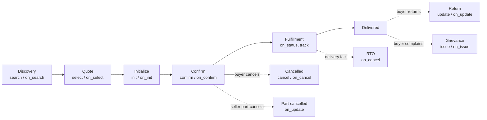

---

## Flow 1: Delivery Flow

The standard order: the buyer selects items, gets a quote, pays online, and receives the order through seller-managed delivery.

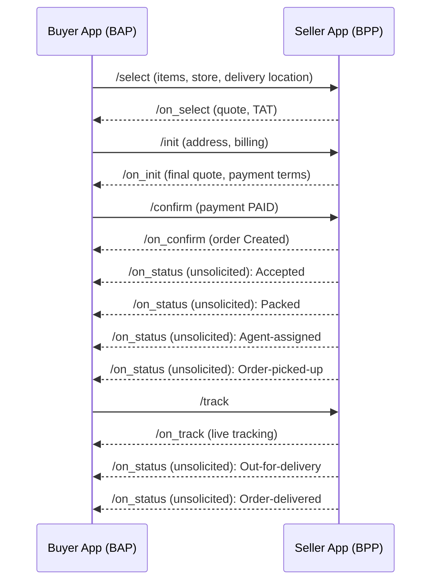

---

## Flow 2: Buyer Delivery Flow

The buyer app arranges delivery. The seller packs the order, and the buyer app reports delivery progress back to the seller.

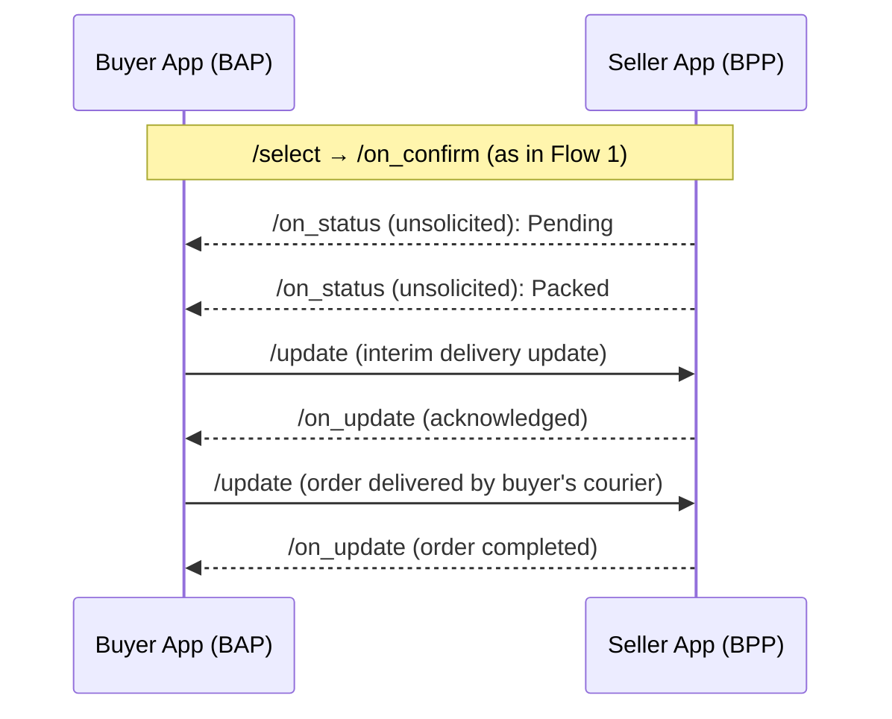

---

## Flow 3: Out of Stock Flow (Error Code)

The seller rejects the first selection because an item is out of stock. The buyer corrects the cart and completes the order.

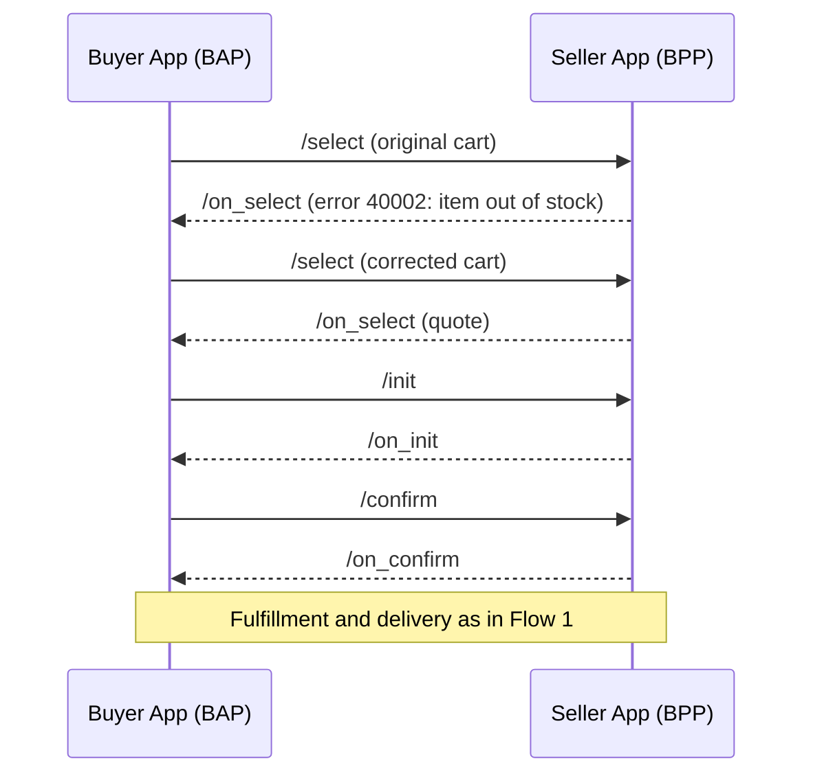

---

## Flow 4: Buyer Cancellation Flow

The buyer cancels a confirmed order before it is shipped.

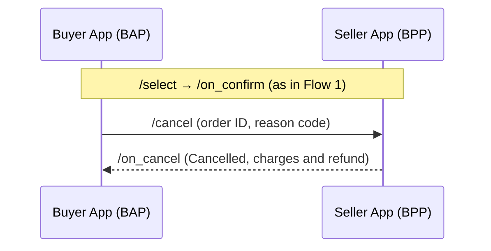

---

## Flow 5: RTO and Part-Cancellation Flow

The seller cancels some items it cannot supply, then delivery of the rest fails and the order returns to the seller (Return to Origin).

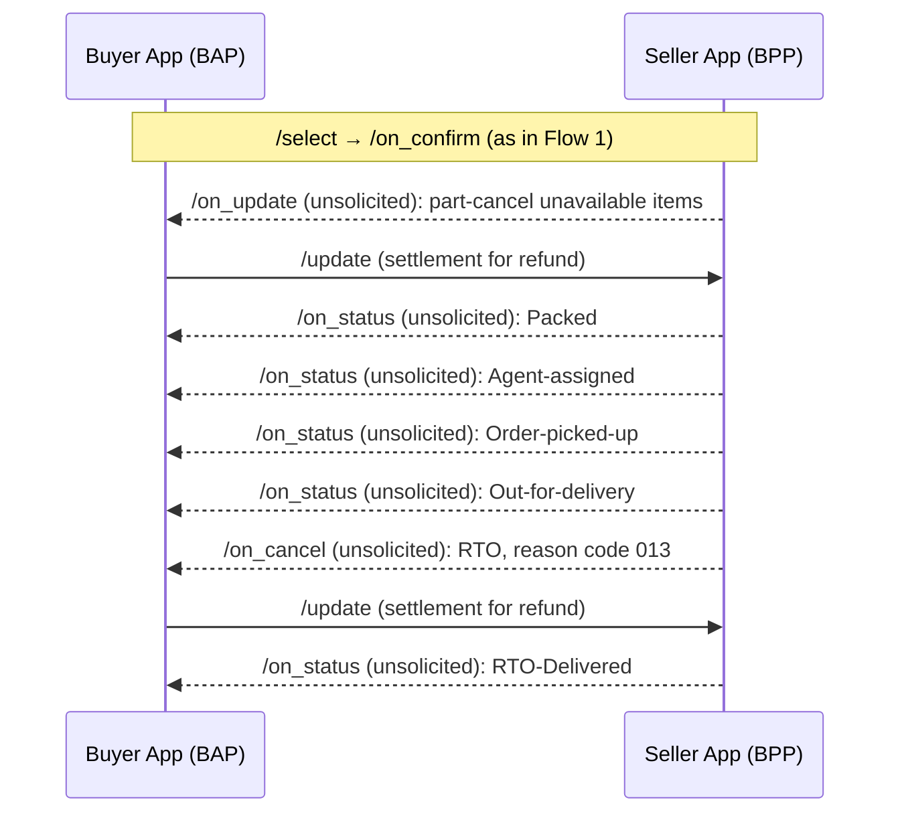

---

## Flow 6: Return Flow

After delivery, the buyer returns an item. The seller approves the return, the item is picked up, and the refund is settled.

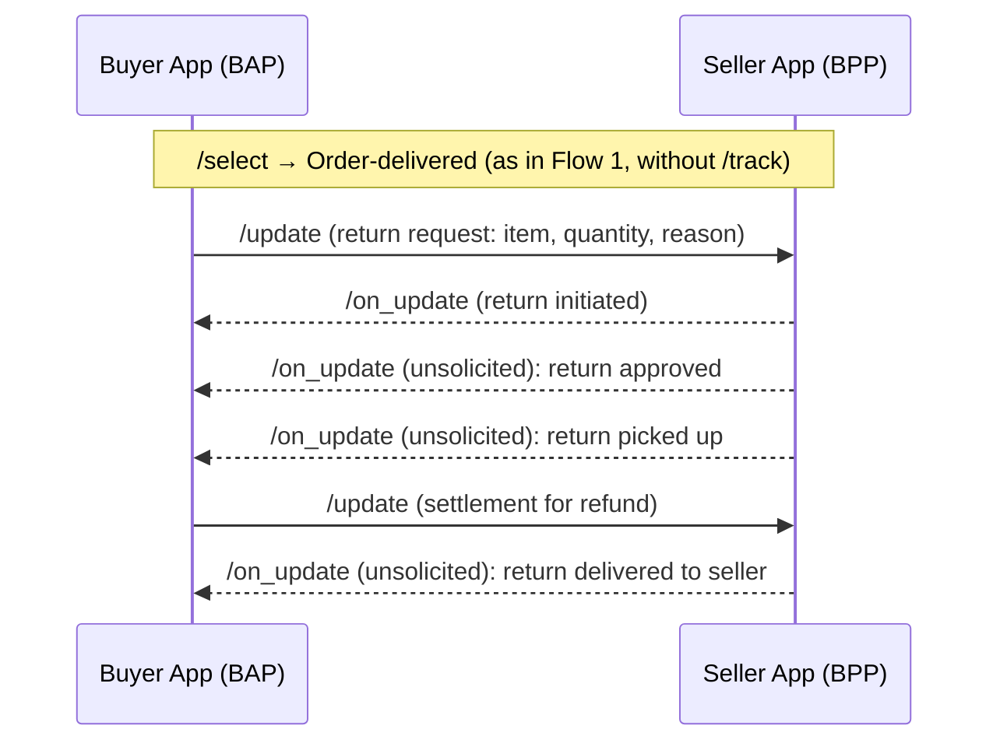

---

## Flow 7: Discovery Flow – Full Catalog

The buyer app searches a city and the seller returns its full catalog.

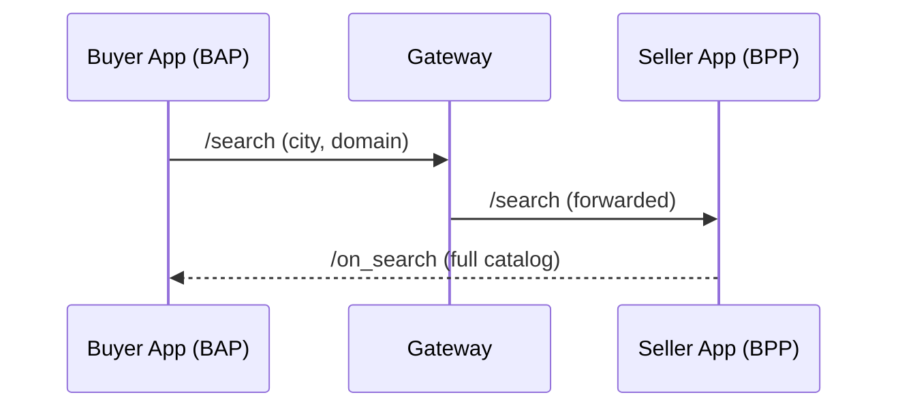

---

## Flow 8: Discovery Flow – Incremental Catalog (Push)

After the first search, the seller pushes catalog changes as they happen, without resending the whole catalog.

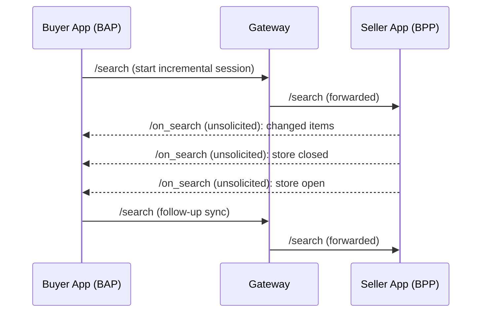

---

## Flow 9: Discovery Flow – Incremental Catalog Refresh (Pull)

The buyer app asks the seller for only the items that changed after a given time.

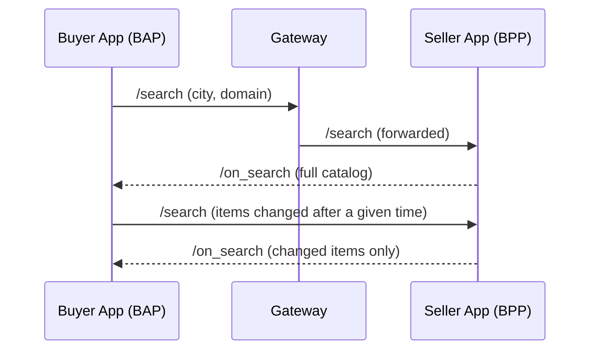

---

## Flow 10: Catalog Rejection Flow

The buyer app finds errors in a seller's catalog and rejects it, telling the seller what is wrong.

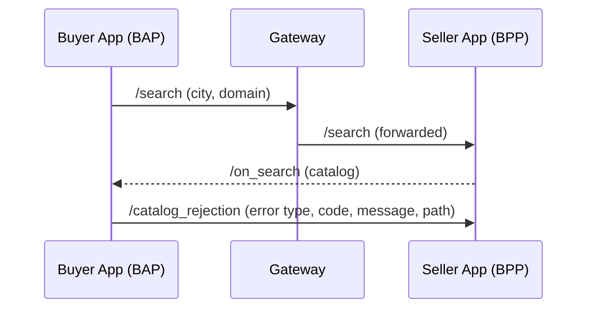

---

## Flow 11: Delivery Flow with IGM 1.0.0

A delivered order followed by a complaint handled under IGM 1.0.0.

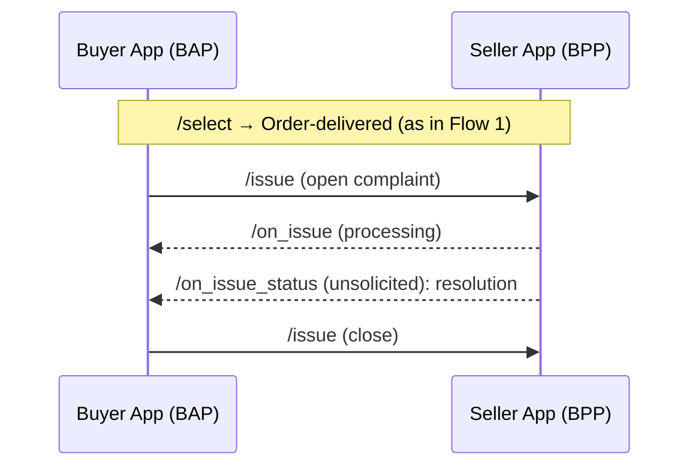

---

## Flow 12: Delivery Flow with IGM 2.0.0 – No Action

The seller resolves the complaint with an explanation and no further action, and the buyer accepts.

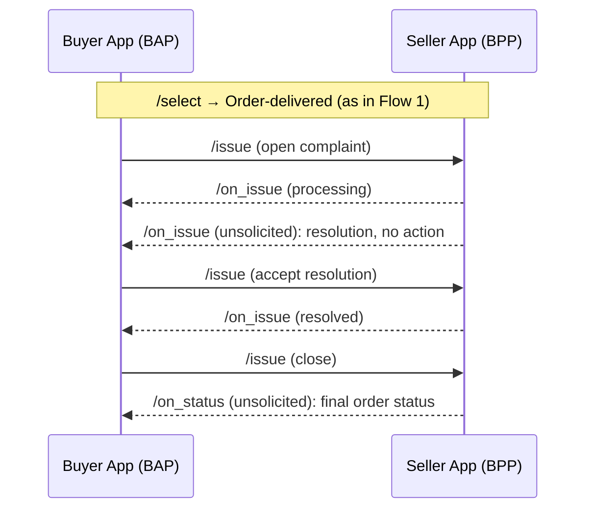

---

## Flow 13: Delivery Flow with IGM 2.0.0 – Rejection and Escalation

The buyer rejects the seller's resolution and escalates the complaint. The final resolution leads to a return.

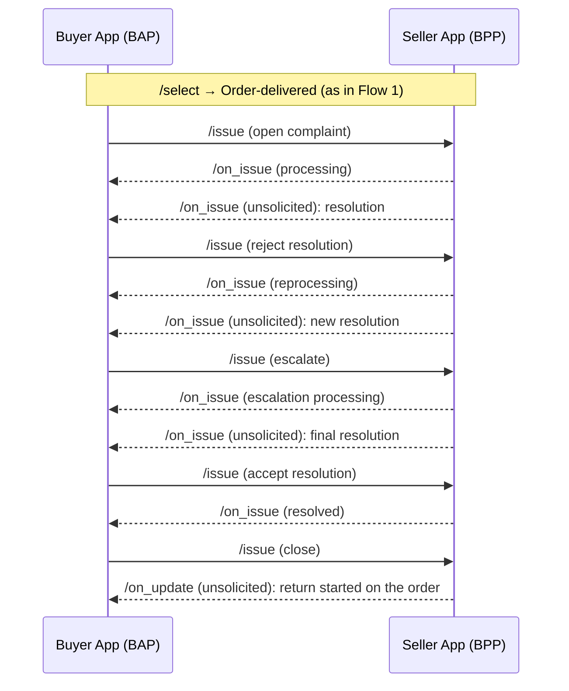

---

## Flow 14: Delivery Flow with IGM 2.0.0

The seller asks for more information, proposes a replacement, and the buyer accepts.

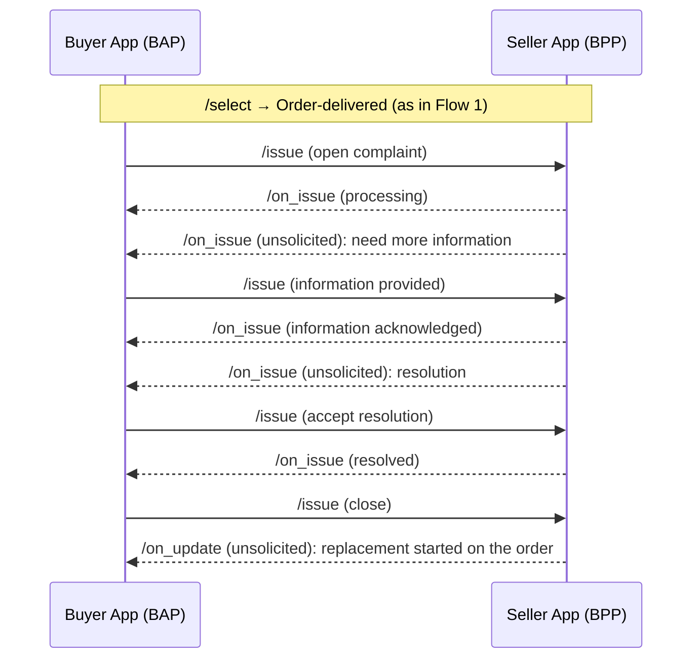
