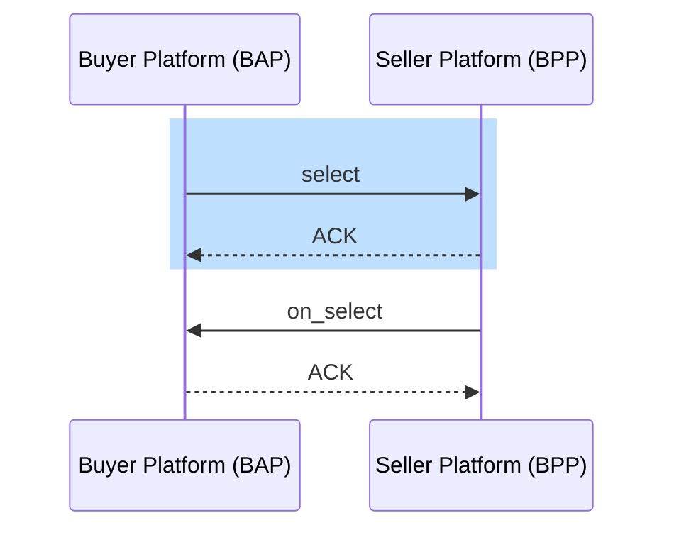
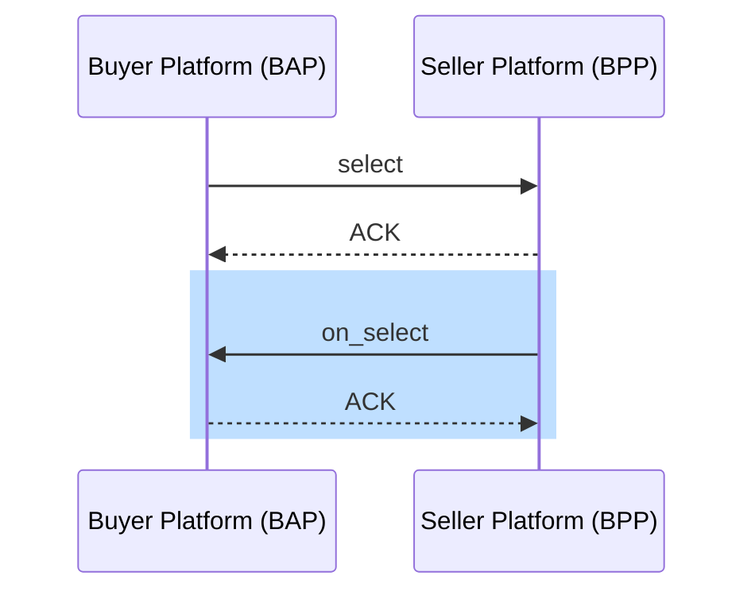
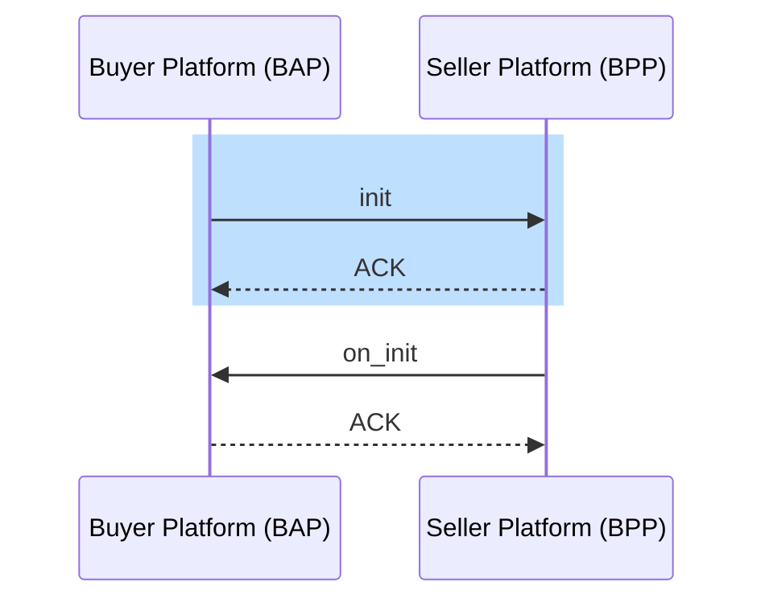
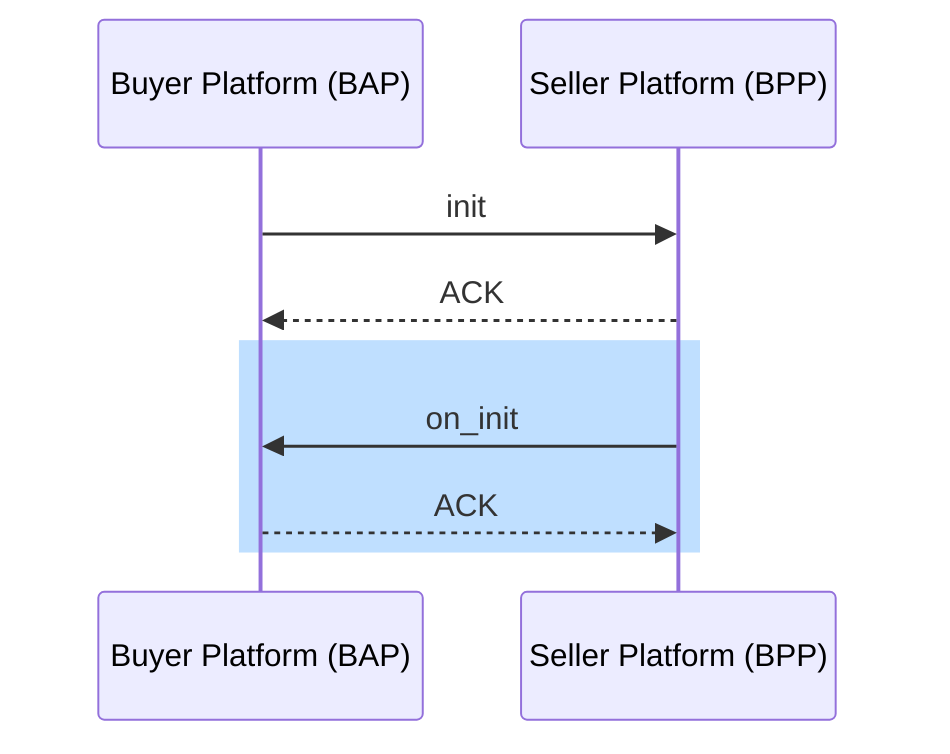
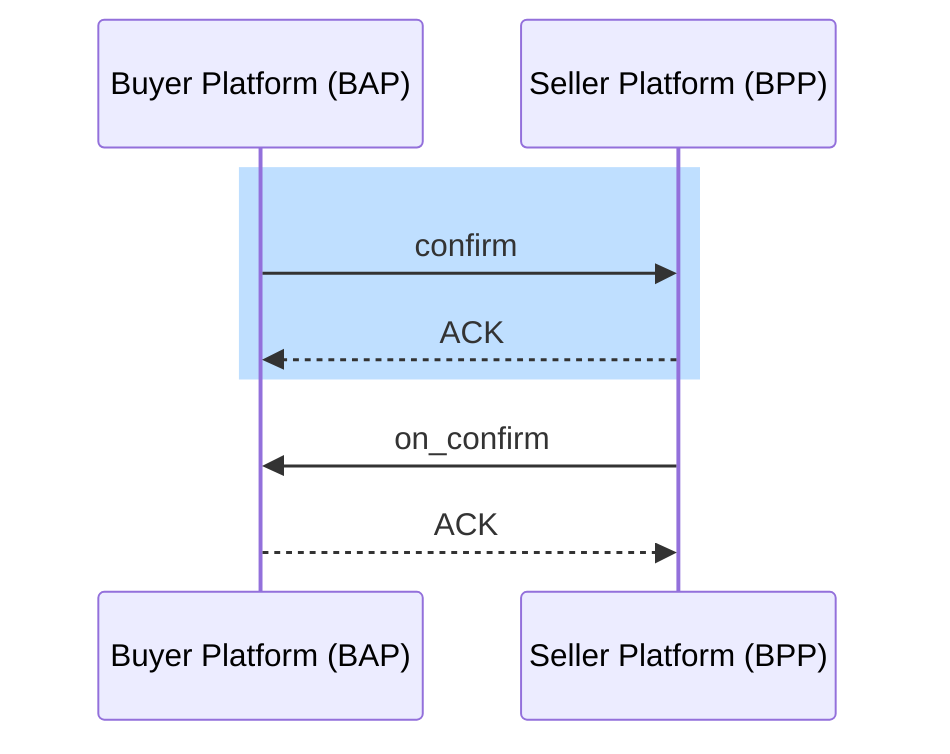
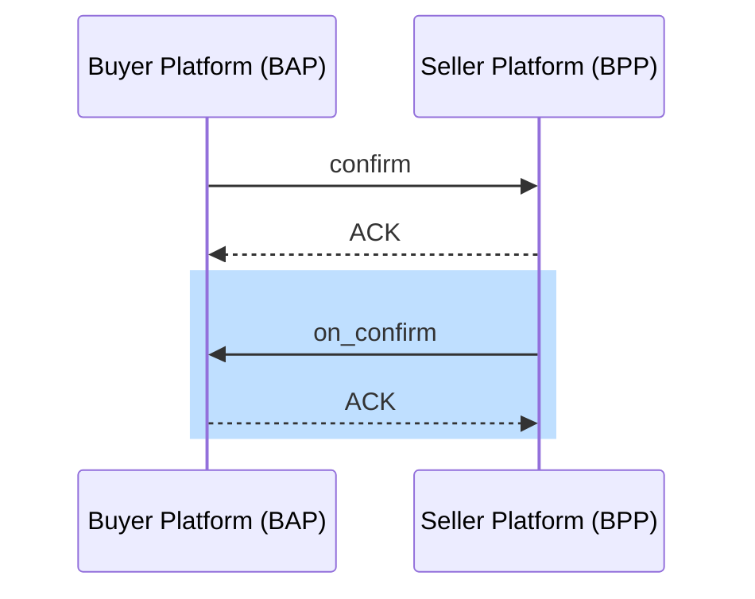
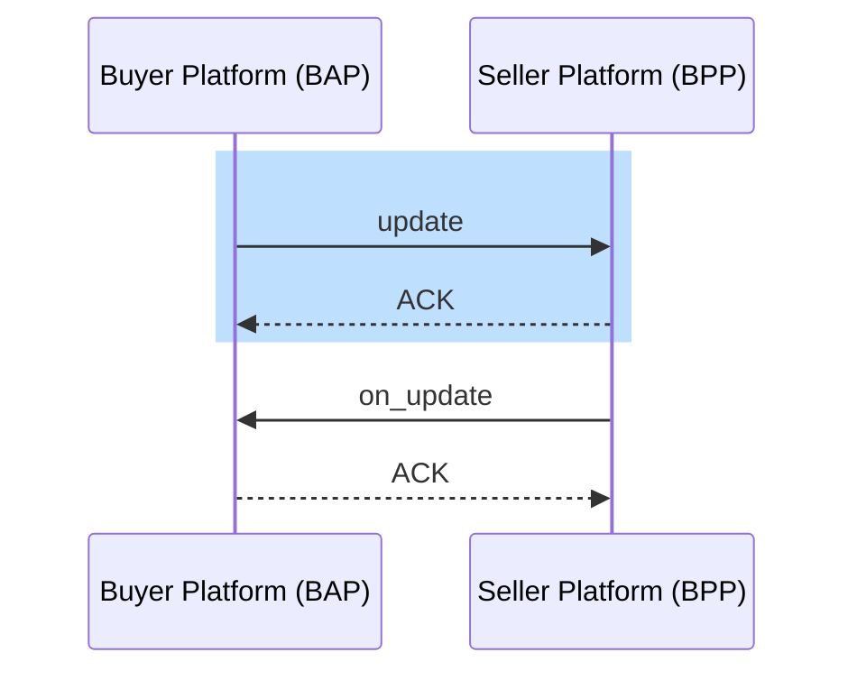
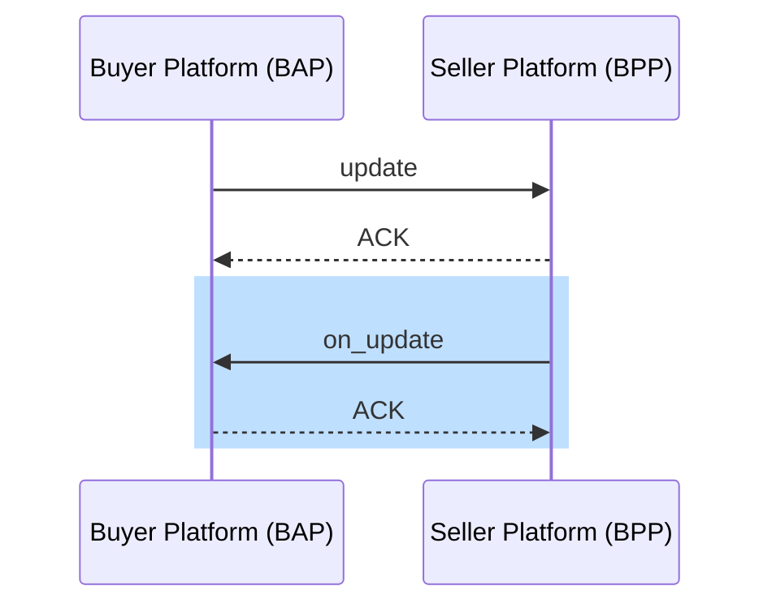

# Lumpsum Payment By Buyer App — Sequence Diagrams

Internal data file consumed by the Developer Guide's "Sequence Diagram" tab (API Walkthrough).
Not meant to be shown as its own docs page — the frontend filters this slug out of the Use Case
Brief / Additional Resources / Changelog tab lists and instead looks up the section matching the
selected API call's `action_id` (the `##` heading below) to render that step's diagram.

One `## <action_id>` heading per step of `Lumpsum_Payment_By_Buyer_App.yaml`, in that flow's own step order, each
followed by its Mermaid `sequenceDiagram`.

update_buyer_payment/on_update_buyer_payment have no dedicated source (the buyer app reports its own payment completion instead of going through a payment-gateway redirection form); reuse the generic update/on_update pair (same role: a buyer-initiated status report, acknowledged by the seller).

## select

## on_select_existing_folio

## init

## on_init_existing_folio

## confirm

## on_confirm_existing_folio

## update_buyer_payment

## on_update_buyer_payment

## on_update_unsolicited_existing_folio

