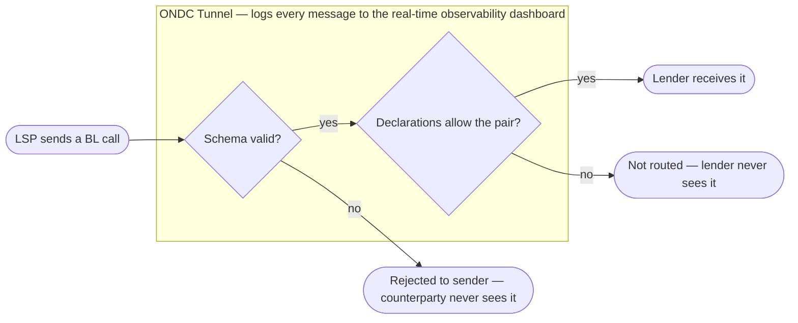

# Business Loans

---

## Overview

Business Loans (BL) on ONDC currently cover unsecured business term loans for Sole Proprietors, Partnerships, Private Limited Companies, and other registered MSMEs. The protocol spans the full lifecycle: digital application, underwriting and offer generation, KYC and sanction, disbursal, and post-disbursal servicing through to closure. Lines of credit and working capital facilities are not currently live on BL, so this guide covers term loans only.

Each lender independently manages its own BL products, underwriting, pricing, and servicing. ONDC enables these lenders and lending apps to connect through a common, open protocol instead of building separate integrations with each other. A lending app integrates with the ONDC network as a Loan Service Provider (LSP) and can discover and offer BL products from participating lenders. Lenders integrate once with the network to make their BL products available to participating lending apps.

BL runs on ONDC Tunnel, the network's common routing layer for credit. Participants send every BL call to the Tunnel endpoint, and Tunnel decides who receives it based on what each side has declared on the ONDC portal.

**Out of Scope**: Explicitly out of scope are secured loans, consumer/personal loans, and anchor-led supply chain finance. Any product falling into these categories belongs to a different protocol/spec, not an extension of this one.

This guide explains the BL use case and end-to-end journey from a business and product perspective, before covering the corresponding technical specifications and API flows. Network interactions in this guide reference the `ONDC:FIS12:BL` domain, version 2.3.0 (`draft-FIS12-2.3.0-BL`).

---

## ONDC Tunnel for BL

Tunnel is a routing and validation layer, similar to the switch that routes UPI payments. It carries and checks BL messages; it does not underwrite, price, sanction, or make lending decisions. Those decisions, and all statutory reporting — including credit bureau reporting — stay with the lender as the regulated entity.

Three Tunnel capabilities are live for BL:

| Capability | What it does for BL | What it replaces |
|---|---|---|
| **Whitelist / blacklist declarations on the ONDC portal** | Lenders declare which LSPs they accept BL traffic from; LSPs declare their lender preferences. Tunnel routes each request only to counterparties those declarations allow. | Private lender lists and per-pair whitelists in each participant's own systems, updated every time a counterparty is added or dropped. |
| **Schema validation** | Every request and response is checked against the network specification before it is routed. A non-conforming message is rejected back to its sender and never reaches the counterparty. | Errors discovered late, inside the counterparty's system or mid-journey. |
| **Real-time network observability dashboard** | Tunnel logs every message it routes and shows BL transaction health across the network in real time. | Participants sharing operational logs separately with Network Observability; visibility limited to each participant's own connections. |

*BL call path through Tunnel · 2 checks*

A call that fails either check stops at Tunnel. Lender responses, including unsolicited status and servicing pushes, pass the same schema check on the way back to the LSP.

Schema validation confirms that a message is well-formed and spec-conformant. It does not check business rules such as offer validity windows, mandate and eSign completion, or KYC outcomes — those stay with the LSP and the lender, as the journey stages below note.

Running BL on Tunnel is a configuration exercise, not a rebuild. Each participant needs to:

1. Point all BL API calls at the Tunnel endpoint.
2. Register participation details and declare whitelist/blacklist preferences on the ONDC portal.
3. Conform to the baselined FIS12 version for BL — payloads that don't conform are rejected at Tunnel.
4. Stop routing on private lender lists and let Tunnel route.
5. Complete end-to-end BL testing on the pre-production environment before production rollout.

---

## Participants

| Participant | What This Means |
|---|---|
| **Lender** | An RBI-regulated lending institution — Scheduled Commercial Bank, NBFC, Co-operative Bank, or Regional Rural Bank. Responsible for its BL catalogue, underwriting, KYC/PD/FV, mandate and eSign execution, disbursal, and servicing. On Tunnel, the lender declares on the ONDC portal which LSPs it accepts BL traffic from. |
| **Lending App (Loan Service Provider)** | A buyer application that offers BL products to its users by connecting with participating lenders through the ONDC network. The LSP handles discovery, consent capture, data collection (banking and GST), offer aggregation, and redirects the borrower into the lender's environment for KYC, mandate, and agreement steps. On Tunnel, the LSP declares its lender preferences on the portal instead of maintaining a private lender list. |
| **Borrower (MSME Entity)** | A sole proprietor, partnership firm, private limited company, or other MSME entity applying for a business term loan. KYC complexity scales with entity type — a private limited company brings director-level KYC and shareholding-pattern requirements that a sole proprietorship does not. |
| **Account Aggregator (AA) & GST Suvidha Provider (GSP)** | Supporting data rails, not core network participants. AA (available for sole proprietors) shares banking data with borrower consent under the DEPA framework; a GSP fetches GSTN profile, GSTR-1, GSTR-2A, and GSTR-3B summaries. Both are stated dual/required paths alongside manual bank-statement upload — the LSP should support them, not treat either as optional. |
| **ONDC Tunnel** | The network's routing and validation layer for credit, operated by ONDC. It routes BL messages according to portal declarations, validates them against the specification, and feeds the network observability dashboard. It is not a party to the loan. |

---

## The User Journey

The BL journey enables a borrower to discover lenders, get evaluated by multiple lenders simultaneously, select an offer, complete KYC and sanction, and receive the loan. Every network interaction below passes through ONDC Tunnel. Steps inside the lender's environment (KYC, PD/FV, mandate, eSign) happen outside the network, so Tunnel sees them only through the status updates the lender sends. The journey consists of the following stages:

### 1. Product Discovery

The LSP initiates a search to identify live lenders and the BL products they currently offer, including the documents required per product. Discovery results should be cached and periodically refreshed rather than re-queried on every borrower session, since catalogues and document requirements change far less often than borrower session volume.

**Network interaction:**

- **`/search`**: The LSP queries the network for available BL products.
- **`/on_search`**: Each lender returns its current BL catalogue and associated document checklist (GST details, Udyam number, etc.) per product.

> **Design Note**: Design for partial results — not every lender responds in the same window, so the LSP should render "what's currently known" rather than blocking on the slowest responder. A lender going offline mid-catalogue-refresh shouldn't surface stale or half-updated product data, and products that are paused (not accepting new applications) should be distinguishable from products that are discontinued.

> **On Tunnel**: Discovery `/search` reaches only lenders whose portal declarations allow this LSP, so the cached catalogue covers only lenders the LSP can actually transact with. Refresh cadence should account for declaration changes as well as catalogue changes. A lender absent from results may be slow, not permitted by declarations, or have had its `/on_search` rejected at Tunnel — the portal and the network observability dashboard help tell these apart.

### 2. Data Collection & Consent

Before retrieving or sharing any financial information, the LSP captures explicit borrower consent — auditable and timestamped independently for each data category (AA, GST, statement upload), since regulatory review may ask for proof of consent per source, not just one blanket event. The LSP then collects:

- **Banking data** via both supported paths: Account Aggregator consent (sole proprietors) and manual upload of the last twelve months of bank statements — this is a stated dual requirement, not a choice of one.
- **GST data** via a GSP integration: GSTN profile, GSTR-1, GSTR-2A, and GSTR-3B summaries. Where a borrower holds multiple GSTINs under one PAN, these are collected one GSTIN at a time, not as a bulk multi-select.
- **Entity-specific documents** based on entity type: financial statements and provisions for the latest financial year, shareholding pattern, list of directors, tax audit report and ITR, and UDYAM number, as applicable.

Because two banking-data paths exist, the underwriting payload sent to lenders should normalize both into a consistent representation, and retain provenance metadata — which path a given data point came from — for audit and dispute resolution.

### 3. Application Broadcast & Underwriting

Once collected, this data is broadcast to every participating lender simultaneously, and each lender begins underwriting using bureau data, banking information, GST returns, and entity details.

**Network interaction:**

- This stage runs on the same `/search` used for discovery — the borrower's full application payload rides on it rather than a separate broadcast action.
- Each lender acknowledges receipt and creates an internal application record promptly, even before a full underwriting decision is ready — this acknowledgment is what lets the LSP confirm the application actually reached each lender, and evaluation itself proceeds asynchronously from there.

A lender that doesn't serve the borrower's entity type or geography should decline early with a clear reason, rather than silently timing out. Duplicate-broadcast protection matters too: a retried broadcast from the LSP side (due to network issues) shouldn't create duplicate application records on the lender's side.

> **On Tunnel**: The LSP sends the application to the Tunnel endpoint, and it reaches only lenders whose declarations permit this LSP. The full payload, including normalized banking and GST data, is schema-validated before any lender sees it. A payload that fails reaches no lender, so the LSP should surface it as a retryable error rather than wait for acknowledgments that won't come. Declarations decide which LSP–lender pairs can transact, not which borrowers a lender serves, so the early decline for entity type or geography still comes from the lender. Tunnel's live checks also don't de-duplicate retried broadcasts — idempotency stays with the lender.

### 4. Offer Generation

Each lender decides product fit and computes the sanctioned amount, tenure, pricing, and fees, returning a complete offer with all KFS-mandated disclosures and a stated validity window.

**Network interaction:**

- **`/on_search`**: Each lender returns its offer as part of the catalogue response described above, including product type, pricing, and KFS terms.

The LSP aggregates offers as they arrive and presents them for like-for-like comparison on amount, tenure, pricing, and fees.

Offer validity windows differ by lender — the LSP should track expiry per offer and reflect stale/expired offers in the UI rather than letting a borrower select one that's lapsed. Since underwriting response times vary by lender, the aggregation view should update incrementally as offers arrive, not wait for every lender to respond.

> **On Tunnel**: Each lender's offer is validated before it reaches the LSP. An offer that fails never appears in the aggregation view, and to the LSP it looks the same as a slow lender. Lenders should monitor Tunnel rejections of their `/on_search` offers rather than assume every offer was delivered.

### 5. Offer Selection

The borrower selects exactly one offer.

**Network interaction:**

- **`/select`**: The LSP notifies the chosen lender of the selection.
- **`/on_select`**: The lender responds with the applicable quote.

Once an offer is selected, the other lenders' offers on that application are implicitly declined — they should be notified so they can close out the application on their side rather than holding it open.

> **On Tunnel**: `/select` and `/on_select` are schema-validated, but validation does not catch selection of an expired offer. Expiry tracking stays with the LSP and lender.

### 6. KYC, Verification & Loan Finalisation

For term loans, KYC runs inside the `/init` / `/on_init` cycle, ahead of mandate setup and eSign. It covers the entity itself, its directors, and any co-applicants — in online or offline mode as required — plus Personal Discussion (PD) or Field Verification (FV) where the lender's policy requires it.

With KYC and verification cleared, the LSP collects the borrower's disbursement account details, facilitates eNACH/standing-instruction mandate creation, and presents the loan agreement for eSign — all rendered within the LSP experience via the lender's forms.

**Network interaction:**

- **`/init`**: The LSP submits the forms the lender requests: KYC first, then mandate setup.
- **`/on_init`**: The lender returns the next form required (KYC, then the e-mandate/payment link details, then the loan-agreement form), with `/on_status` pushes marking completion of each sub-step in between.
- **`/confirm`**: The LSP submits the signed agreement and confirms.
- **`/on_confirm`**: The lender confirms the booking and disburses funds to the borrower's account.

PD/FV can introduce multi-day latency, so the LSP's status messaging should reflect "in verification" as distinct from "under review." KYC failure at the director or co-applicant level should be surfaced with enough specificity that the borrower knows what to remedy.

Mandate and eSign completion are hard gates — disbursal shouldn't proceed on an incomplete mandate or unsigned agreement, even under pressure to move faster.

> **On Tunnel**: `/init`, `/on_init`, `/confirm`, `/on_confirm`, and every `/on_status` pass through Tunnel; KYC, PD/FV, mandate, and eSign themselves happen in the lender's environment, outside the network. During multi-day PD/FV, the network observability dashboard shows only what the lender reports, so lenders should push `/on_status` at each completed step. Tunnel checks that `/confirm` is well-formed, not that the mandate is live or the agreement signed — those hard gates stay with the lender.

---

## Additional Scenarios

> **On Tunnel**: All servicing calls (`/status`, `/update` and their callbacks) pass through Tunnel and are validated like journey calls. That includes the lender's unsolicited `/on_status` and `/on_update` pushes.

### 1. Loan Visibility

The LSP maintains a dashboard of all active and closed loans, kept current via lender-provided APIs rather than point-in-time snapshots. It shows the repayment schedule, EMIs, and dues for each loan.

**Network interaction:**

- **`/status`**: The LSP requests current loan state.
- **`/on_status`**: The lender returns real-time status, usage, repayment, and overdue information, and proactively pushes state changes — part-payments, reversals — rather than requiring the LSP to poll for every change.

Overdue status should be a first-class field distinct from "amount due," since it affects both borrower messaging and downstream credit bureau reporting.

> **On Tunnel**: A proactive push that fails validation is rejected at Tunnel, and the LSP's dashboard silently stays stale. Lenders should monitor rejections of their unsolicited `/on_status` and `/on_update` messages, since nothing on the LSP side will flag the gap.

### 2. Repayment, Prepayment & Missed-Payment Servicing

Borrowers can track upcoming repayments, make part-prepayments, or catch up on a missed EMI — where the lender supports each, since this is lender-dependent and the LSP should reflect what's actually available per loan.

**Network interaction — part-prepayment:**

- **`/update`**: The borrower requests a part-prepayment (directly on the loan).
- **`/on_update`**: Payment details $\rightarrow$ payment success $\rightarrow$ quotation updated on the base order. The lender returns the applicable amount and charges; once paid, confirms success and updates the base-order quotation.

**Network interaction — missed EMI:**

- **`/update`**: The borrower requests missed-EMI payment details.
- **`/on_update`**: Payment details $\rightarrow$ payment success $\rightarrow$ base transaction quotation updated. Same three-step pattern as part-prepayment, scoped to the missed instalment.

Prepayment charges, if any, should be computed and disclosed before the payment is confirmed, not after — this ties back to the KFS disclosure obligations established at offer stage. Failed mandate collections (e.g., insufficient funds) should be distinguishable in the state model from a borrower-initiated missed payment, since they may trigger different retry and communication flows.

### 3. Foreclosure

**Network interaction:**

- **`/update`**: The borrower requests foreclosure of the loan.
- **`/on_update`**: Foreclosure payment details $\rightarrow$ payment success $\rightarrow$ base transaction quotation updated. The lender returns the foreclosure amount and charges; once paid, confirms success and updates the base order.

### 4. Loan Closure & Lifecycle Events

Once all dues are settled, the lender closes the loan, updates internal systems and credit bureau reporting, and sends closure confirmation to the LSP, which shows the borrower a closure confirmation and, where available, a final statement.

Closure should be treated as a terminal state only after bureau reporting is confirmed updated, not immediately on dues clearing — a premature "closed" status shown ahead of bureau updates can create disputes if the borrower's credit report doesn't reflect it yet.

---

## Issue and Grievance Management

IGM handling is standardized across FIS12, so an LSP or lender that has already implemented IGM for another FIS12 lending product (Personal Loans, LAMF) should be able to reuse that implementation for Business Loans rather than building a separate grievance pipeline. A borrower raises a grievance through the LSP, which routes it to the relevant lender via the network's common grievance mechanism; the lender investigates and communicates status and resolution back to the LSP, which relays it to the borrower.

This section wasn't detailed in the source BRD for Business Loans specifically — it's included here for structural consistency with the Personal Loans and LAMF guides, since IGM is a FIS12-wide mechanism rather than a per-product one. Worth confirming with whoever owns the BL BRD whether there are BL-specific grievance scenarios (e.g., disputed prepayment or foreclosure charges, a closure not yet reflected in the borrower's credit report) worth calling out explicitly, the way margin-call disputes are called out for LAMF.

> **On Tunnel**: For disputes over a message the borrower says never arrived — a disbursal confirmation, a payment confirmation, a closure notice — the first question is where it stopped: never sent, rejected at Tunnel, or delivered to the LSP but not shown. Tunnel's network-side logs can help answer this without each side reconciling its own logs first.
