# Purchase Finance Without AA Cancellation — Sequence Diagrams

Internal data file consumed by the Developer Guide's "Sequence Diagram" tab (API Walkthrough).
Not meant to be shown as its own docs page — the frontend filters this slug out of the Use Case
Brief / Additional Resources / Changelog tab lists and instead looks up the section matching the
selected API call's `action_id` (the `##` heading below) to render that step's diagram.

One `## <action_id>` heading per step of `Purchase_Finance_Without_AA_Cancellation.yaml`, in that flow's own step order, each
followed by its Mermaid `sequenceDiagram`.

on_status_unsolicited / on_status_emandate_unsolicited / on_status_esign_unsolicited have no dedicated source anywhere in this spec version (neither Purchase_Finance nor Purchase_Finance-_Without_Account_Aggregator has any on_status step, and the older Personal_Loan flows in this same spec version have the identical gap -- no per-form on_status between their KYC/mandate/e-sign stages either). All three reuse the Personal Loan Single Redirection pilot's on_status_kyc_verification diagram (draft-FIS12-2.0.3) -- the same 'unsolicited status after a form' API call, already established there.

## search1_purchase_finance

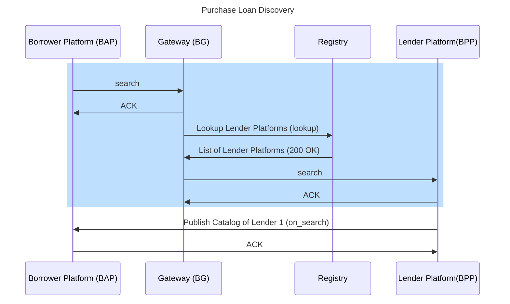

## on_search1_purchase_finance

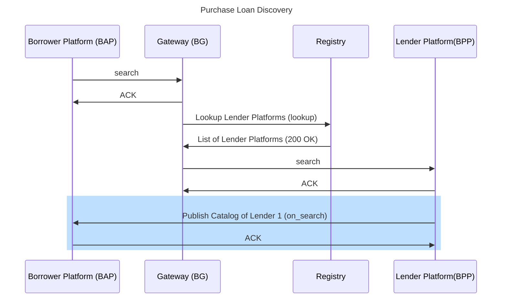

## product_details_form

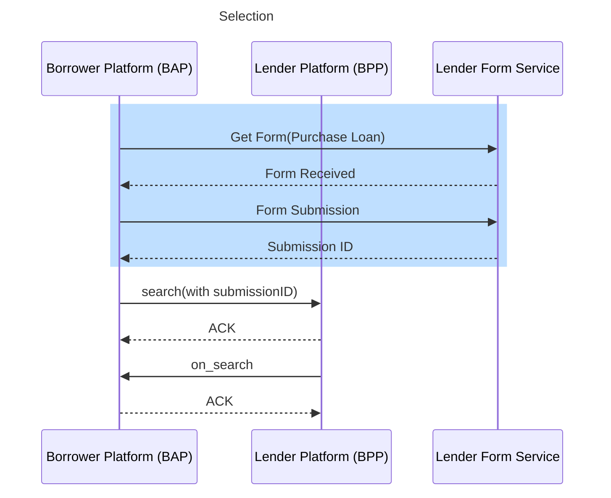

## search2_purchase_finance

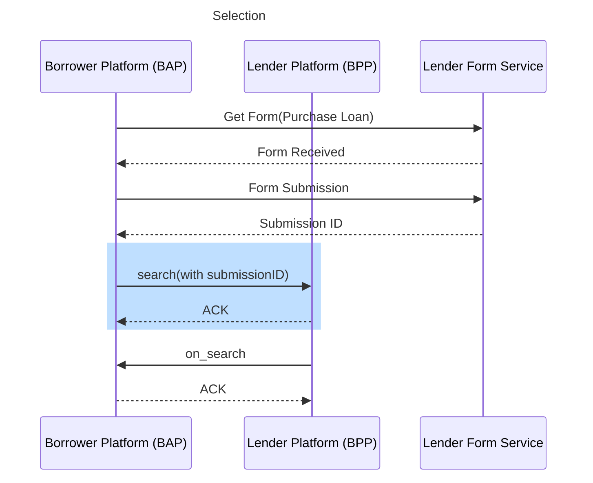

## on_search2_purchase_finance

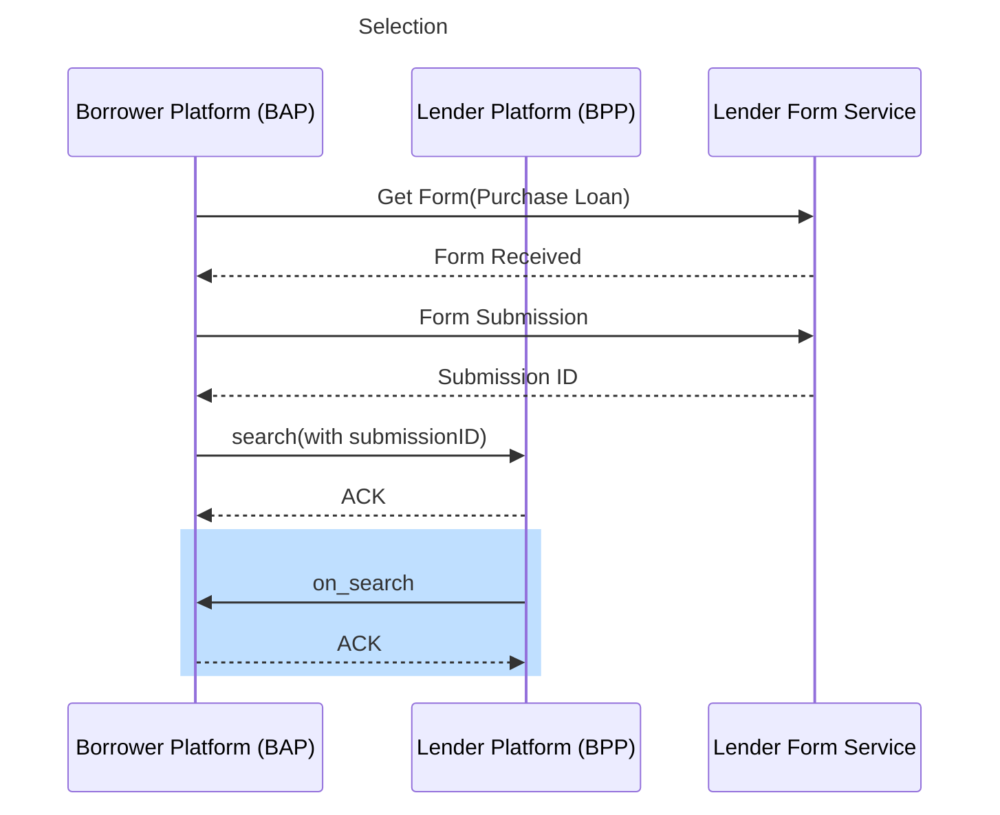

## personal_details_information_form


## search3_purchase_finance


## on_search3_purchase_finance

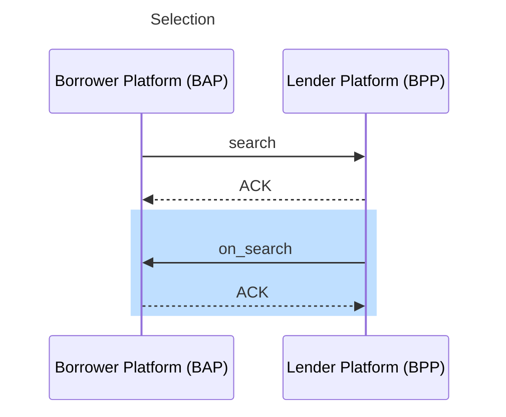

## select_purchase_finance

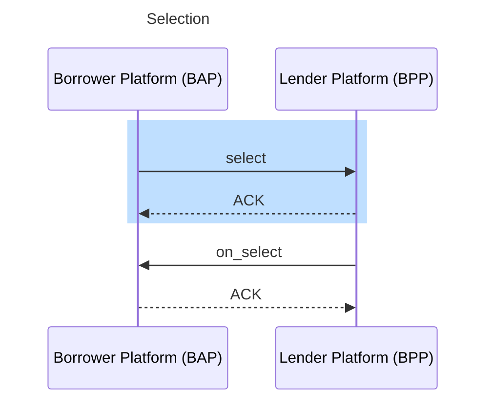

## on_select_purchase_finance


## down_payment_form

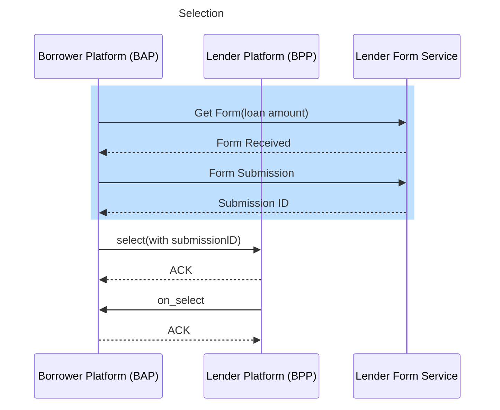

## select1_purchase_finance


## on_select1_purchase_finance


## Ekyc_details_verification_status

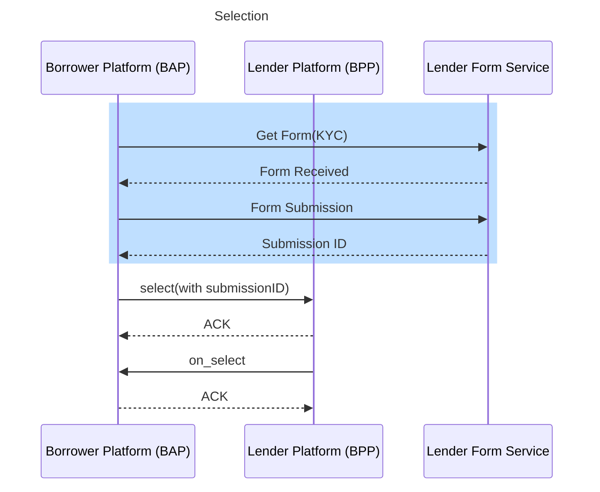

## on_status_unsolicited

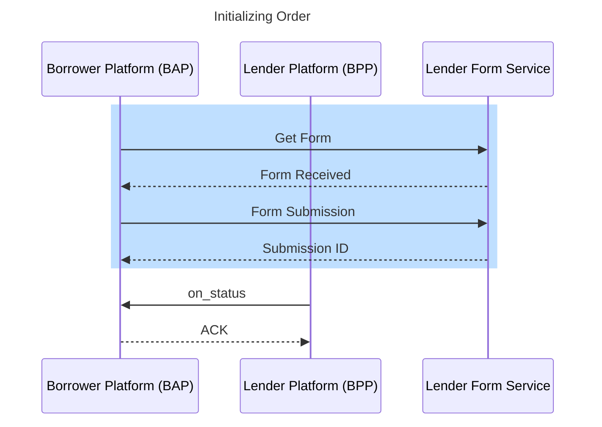

## select2_purchase_finance


## on_select2_purchase_finance


## init1_purchase_finance

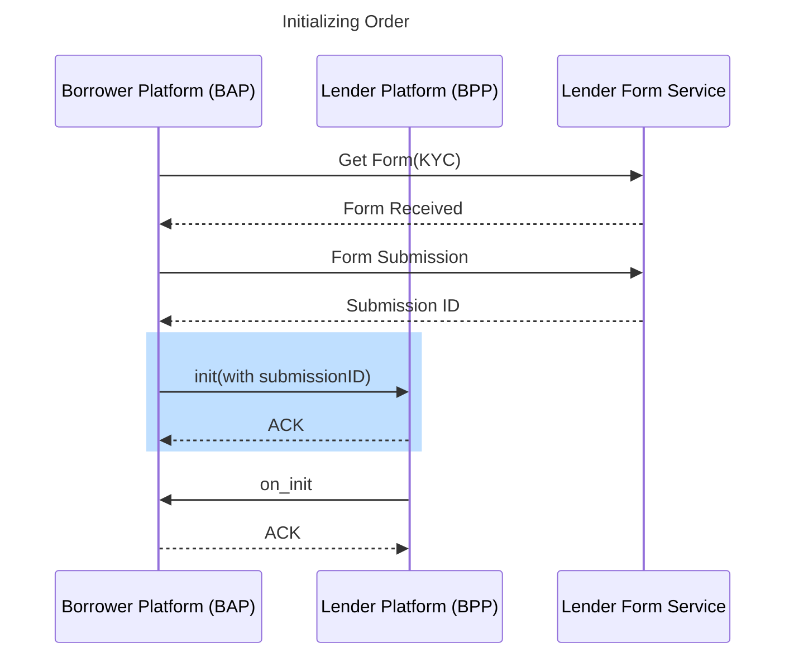

## on_init1_purchase_finance

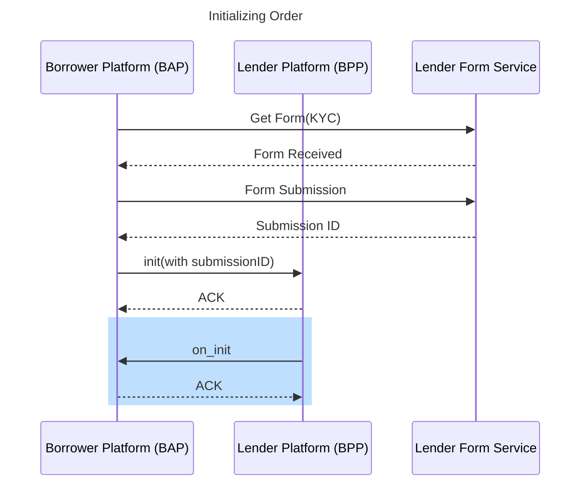

## Emanadate_verification_status

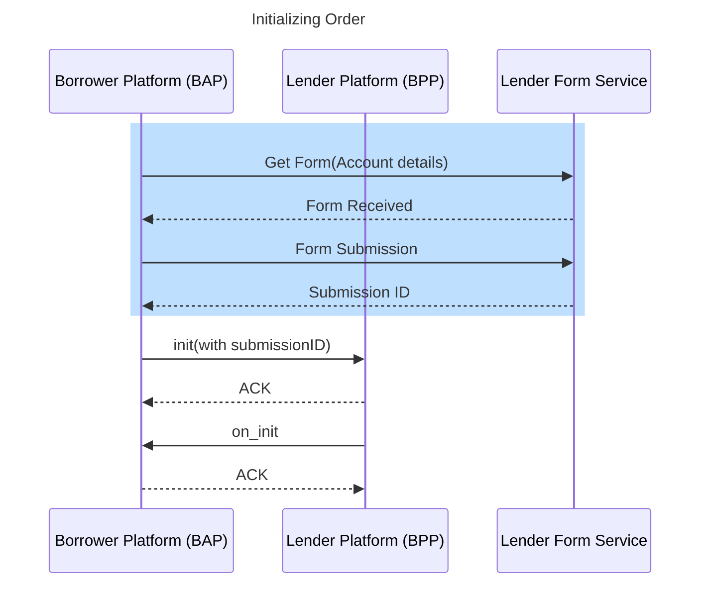

## on_status_emandate_unsolicited

```mermaid
sequenceDiagram
  title Initializing Order
  participant Borrower Platform (BAP)
  participant Lender Platform (BPP)
  participant Lender Form Service
  rect rgb(191, 223, 255)
  Borrower Platform (BAP)->>Lender Form Service: Get Form
  Lender Form Service-->>Borrower Platform (BAP): Form Received
  Borrower Platform (BAP)->>Lender Form Service: Form Submission
  Lender Form Service-->>Borrower Platform (BAP): Submission ID
  end
  Lender Platform (BPP)->>Borrower Platform (BAP):on_status
  Borrower Platform (BAP)-->>Lender Platform (BPP): ACK
```

## init2_purchase_finance

```mermaid
sequenceDiagram
  title Initializing Order
  participant Borrower Platform (BAP)
  participant Lender Platform (BPP)
  participant Lender Form Service
  Borrower Platform (BAP)->>Lender Form Service: Get Form(Account details)
  Lender Form Service-->>Borrower Platform (BAP): Form Received
  Borrower Platform (BAP)->>Lender Form Service: Form Submission
  Lender Form Service-->>Borrower Platform (BAP): Submission ID
  rect rgb(191, 223, 255)
  Borrower Platform (BAP)->>Lender Platform (BPP): init(with submissionID)
  Lender Platform (BPP)-->>Borrower Platform (BAP):ACK
  end
  Lender Platform (BPP)->>Borrower Platform (BAP):on_init
  Borrower Platform (BAP)-->>Lender Platform (BPP): ACK
```

## on_init2_purchase_finance

```mermaid
sequenceDiagram
  title Initializing Order
  participant Borrower Platform (BAP)
  participant Lender Platform (BPP)
  participant Lender Form Service
  Borrower Platform (BAP)->>Lender Form Service: Get Form(Account details)
  Lender Form Service-->>Borrower Platform (BAP): Form Received
  Borrower Platform (BAP)->>Lender Form Service: Form Submission
  Lender Form Service-->>Borrower Platform (BAP): Submission ID
  Borrower Platform (BAP)->>Lender Platform (BPP): init(with submissionID)
  Lender Platform (BPP)-->>Borrower Platform (BAP):ACK
  rect rgb(191, 223, 255)
  Lender Platform (BPP)->>Borrower Platform (BAP):on_init
  Borrower Platform (BAP)-->>Lender Platform (BPP): ACK
  end
```

## E_sign_verification_status

```mermaid
sequenceDiagram
  title Initializing Order
  participant Borrower Platform (BAP)
  participant Lender Platform (BPP)
  participant Lender Form Service
  rect rgb(191, 223, 255)
  Borrower Platform (BAP)->>Lender Form Service: Get Form(e-sign details)
  Lender Form Service-->>Borrower Platform (BAP): Form Received
  Borrower Platform (BAP)->>Lender Form Service: Form Submission
  Lender Form Service-->>Borrower Platform (BAP): Submission ID
  end
  Borrower Platform (BAP)->>Lender Platform (BPP): init(with submissionID)
  Lender Platform (BPP)-->>Borrower Platform (BAP):ACK
  Lender Platform (BPP)->>Borrower Platform (BAP):on_init
  Borrower Platform (BAP)-->>Lender Platform (BPP): ACK
```

## on_status_esign_unsolicited

```mermaid
sequenceDiagram
  title Initializing Order
  participant Borrower Platform (BAP)
  participant Lender Platform (BPP)
  participant Lender Form Service
  rect rgb(191, 223, 255)
  Borrower Platform (BAP)->>Lender Form Service: Get Form
  Lender Form Service-->>Borrower Platform (BAP): Form Received
  Borrower Platform (BAP)->>Lender Form Service: Form Submission
  Lender Form Service-->>Borrower Platform (BAP): Submission ID
  end
  Lender Platform (BPP)->>Borrower Platform (BAP):on_status
  Borrower Platform (BAP)-->>Lender Platform (BPP): ACK
```

## init3_purchase_finance

```mermaid
sequenceDiagram
  title Initializing Order
  participant Borrower Platform (BAP)
  participant Lender Platform (BPP)
  participant Lender Form Service
  Borrower Platform (BAP)->>Lender Form Service: Get Form
  Lender Form Service-->>Borrower Platform (BAP): Form Received
  Borrower Platform (BAP)->>Lender Form Service: Form Submission
  Lender Form Service-->>Borrower Platform (BAP): Submission ID
  rect rgb(191, 223, 255)
  Borrower Platform (BAP)->>Lender Platform (BPP): init(with submissionID)
  Lender Platform (BPP)-->>Borrower Platform (BAP):ACK
  end
  Lender Platform (BPP)->>Borrower Platform (BAP):on_init
  Borrower Platform (BAP)-->>Lender Platform (BPP): ACK
```

## on_init3_purchase_finance

```mermaid
sequenceDiagram
  title Initializing Order
  participant Borrower Platform (BAP)
  participant Lender Platform (BPP)
  participant Lender Form Service
  Borrower Platform (BAP)->>Lender Form Service: Get Form
  Lender Form Service-->>Borrower Platform (BAP): Form Received
  Borrower Platform (BAP)->>Lender Form Service: Form Submission
  Lender Form Service-->>Borrower Platform (BAP): Submission ID
  Borrower Platform (BAP)->>Lender Platform (BPP): init(with submissionID)
  Lender Platform (BPP)-->>Borrower Platform (BAP):ACK
  rect rgb(191, 223, 255)
  Lender Platform (BPP)->>Borrower Platform (BAP):on_init
  Borrower Platform (BAP)-->>Lender Platform (BPP): ACK
  end
```

## confirm_purchase_finance

```mermaid
sequenceDiagram
  title Order Confirmation
  participant Borrower Platform (BAP)
  participant Lender Platform (BPP)
  participant Lender Form Service
  Borrower Platform (BAP)->>Lender Form Service: Get Form(e-sign)
  Lender Form Service-->>Borrower Platform (BAP): Form Received
  Borrower Platform (BAP)->>Lender Form Service: Form Submission
  Lender Form Service-->>Borrower Platform (BAP): Submission ID
  rect rgb(191, 223, 255)
  Borrower Platform (BAP)->>Lender Platform (BPP): confirm(with submissionID)
  Lender Platform (BPP)-->>Borrower Platform (BAP):ACK
  end
  Lender Platform (BPP)->>Borrower Platform (BAP):on_confirm
  Borrower Platform (BAP)-->>Lender Platform (BPP): ACK
```

## on_confirm_purchase_finance

```mermaid
sequenceDiagram
  title Order Confirmation
  participant Borrower Platform (BAP)
  participant Lender Platform (BPP)
  participant Lender Form Service
  Borrower Platform (BAP)->>Lender Form Service: Get Form(e-sign)
  Lender Form Service-->>Borrower Platform (BAP): Form Received
  Borrower Platform (BAP)->>Lender Form Service: Form Submission
  Lender Form Service-->>Borrower Platform (BAP): Submission ID
  Borrower Platform (BAP)->>Lender Platform (BPP): confirm(with submissionID)
  Lender Platform (BPP)-->>Borrower Platform (BAP):ACK
  rect rgb(191, 223, 255)
  Lender Platform (BPP)->>Borrower Platform (BAP):on_confirm
  Borrower Platform (BAP)-->>Lender Platform (BPP): ACK
  end
```

## update_purchase_finance

```mermaid
sequenceDiagram
  title Order Fulfillment
  participant Borrower Platform (BAP)
  participant Lender Platform (BPP)
  rect rgb(191, 223, 255)
  Borrower Platform (BAP)->>Lender Platform (BPP): update-Request
  Lender Platform (BPP)-->>Borrower Platform (BAP):ACK
  end
  Lender Platform (BPP)->>Borrower Platform (BAP):on_update
  Borrower Platform (BAP)-->>Lender Platform (BPP): ACK
  Lender Platform (BPP)->>Borrower Platform (BAP):on_status
  Borrower Platform (BAP)-->>Lender Platform (BPP): ACK
```

## on_update_purchase_finance

```mermaid
sequenceDiagram
  title Order Fulfillment
  participant Borrower Platform (BAP)
  participant Lender Platform (BPP)
  Borrower Platform (BAP)->>Lender Platform (BPP): update-Request
  Lender Platform (BPP)-->>Borrower Platform (BAP):ACK
  rect rgb(191, 223, 255)
  Lender Platform (BPP)->>Borrower Platform (BAP):on_update
  Borrower Platform (BAP)-->>Lender Platform (BPP): ACK
  end
  Lender Platform (BPP)->>Borrower Platform (BAP):on_update
  Borrower Platform (BAP)-->>Lender Platform (BPP): ACK
```

## on_update1_unsolicited_purchase_finance

```mermaid
sequenceDiagram
  title Order Fulfillment
  participant Borrower Platform (BAP)
  participant Lender Platform (BPP)
  Borrower Platform (BAP)->>Lender Platform (BPP): update-Request
  Lender Platform (BPP)-->>Borrower Platform (BAP):ACK
  Lender Platform (BPP)->>Borrower Platform (BAP):on_update
  Borrower Platform (BAP)-->>Lender Platform (BPP): ACK
  rect rgb(191, 223, 255)
  Lender Platform (BPP)->>Borrower Platform (BAP):on_update
  Borrower Platform (BAP)-->>Lender Platform (BPP): ACK
  end
```

## soft_cancel_purchase_finance

```mermaid
sequenceDiagram
  title Order Fulfillment
  participant Borrower Platform (BAP)
  participant Lender Platform (BPP)
  Lender Platform (BPP)->>Borrower Platform (BAP):on_update
  Borrower Platform (BAP)-->>Lender Platform (BPP): ACK
  rect rgb(191, 223, 255)
  Borrower Platform (BAP)->>Lender Platform (BPP): cancel-Request
  Lender Platform (BPP)-->>Borrower Platform (BAP):ACK
  end
  Lender Platform (BPP)->>Borrower Platform (BAP):on_cancel
  Borrower Platform (BAP)-->>Lender Platform (BPP): ACK
```

## soft_on_cancel_purchase_finance

```mermaid
sequenceDiagram
  title Order Fulfillment
  participant Borrower Platform (BAP)
  participant Lender Platform (BPP)
  Lender Platform (BPP)->>Borrower Platform (BAP):on_update
  Borrower Platform (BAP)-->>Lender Platform (BPP): ACK
  Borrower Platform (BAP)->>Lender Platform (BPP): cancel-Request
  Lender Platform (BPP)-->>Borrower Platform (BAP):ACK
  rect rgb(191, 223, 255)
  Lender Platform (BPP)->>Borrower Platform (BAP):on_cancel
  Borrower Platform (BAP)-->>Lender Platform (BPP): ACK
  end
```

## confirmed_cancel_purchase_finance

```mermaid
sequenceDiagram
  title Order Fulfillment
  participant Borrower Platform (BAP)
  participant Lender Platform (BPP)
  rect rgb(191, 223, 255)
  Borrower Platform (BAP)->>Lender Platform (BPP): cancel-Request
  Lender Platform (BPP)-->>Borrower Platform (BAP):ACK
  end
  Lender Platform (BPP)->>Borrower Platform (BAP):on_cancel
  Borrower Platform (BAP)-->>Lender Platform (BPP): ACK
  Lender Platform (BPP)->>Borrower Platform (BAP):on_update
  Borrower Platform (BAP)-->>Lender Platform (BPP): ACK
```

## confirmed_on_cancel_purchase_finance

```mermaid
sequenceDiagram
  title Order Fulfillment
  participant Borrower Platform (BAP)
  participant Lender Platform (BPP)
  Borrower Platform (BAP)->>Lender Platform (BPP): cancel-Request
  Lender Platform (BPP)-->>Borrower Platform (BAP):ACK
  rect rgb(191, 223, 255)
  Lender Platform (BPP)->>Borrower Platform (BAP):on_cancel
  Borrower Platform (BAP)-->>Lender Platform (BPP): ACK
  end
  Lender Platform (BPP)->>Borrower Platform (BAP):on_update
  Borrower Platform (BAP)-->>Lender Platform (BPP): ACK
```

## on_update_unsolicited_cancel

```mermaid
sequenceDiagram
  title Order Fulfillment
  participant Borrower Platform (BAP)
  participant Lender Platform (BPP)
  Borrower Platform (BAP)->>Lender Platform (BPP): cancel-Request
  Lender Platform (BPP)-->>Borrower Platform (BAP):ACK
  Lender Platform (BPP)->>Borrower Platform (BAP):on_cancel
  Borrower Platform (BAP)-->>Lender Platform (BPP): ACK
  rect rgb(191, 223, 255)
  Lender Platform (BPP)->>Borrower Platform (BAP):on_update
  Borrower Platform (BAP)-->>Lender Platform (BPP): ACK
  end
```
