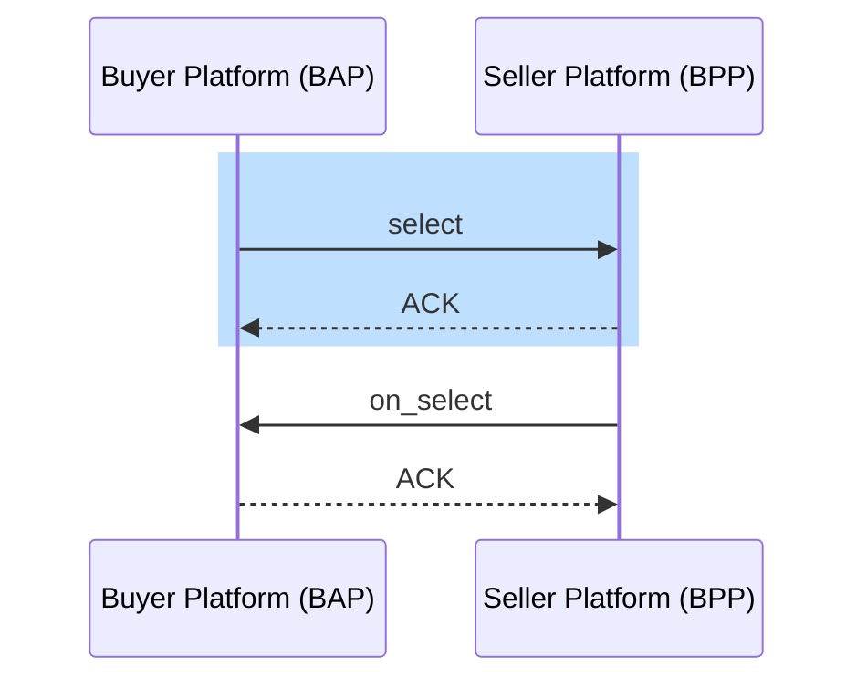
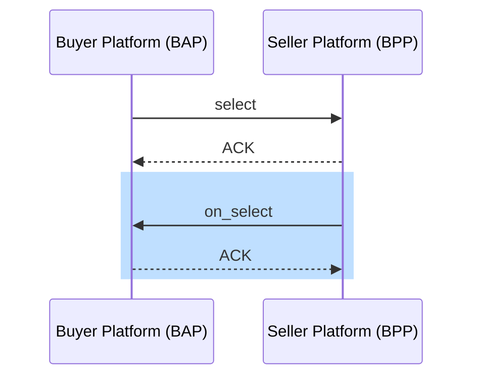
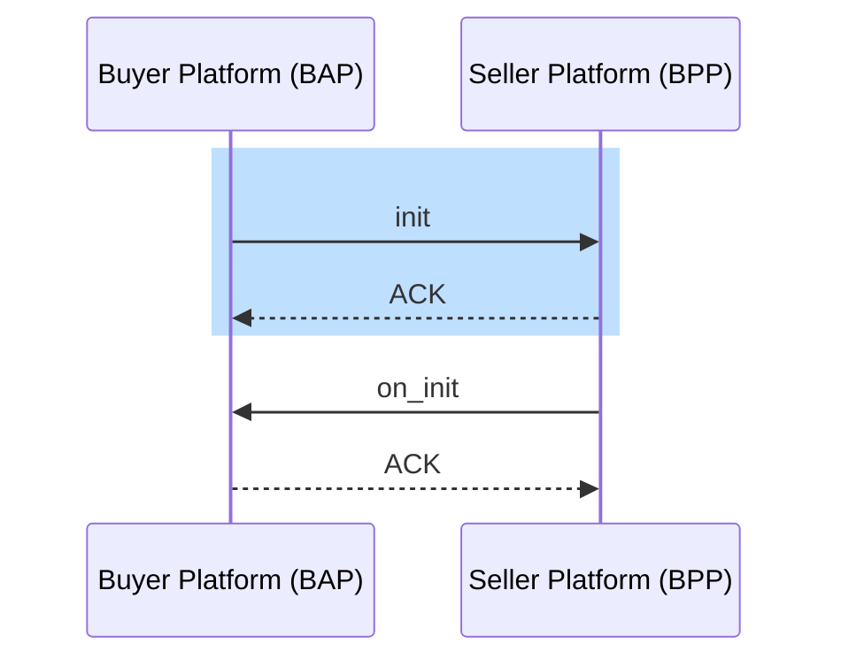
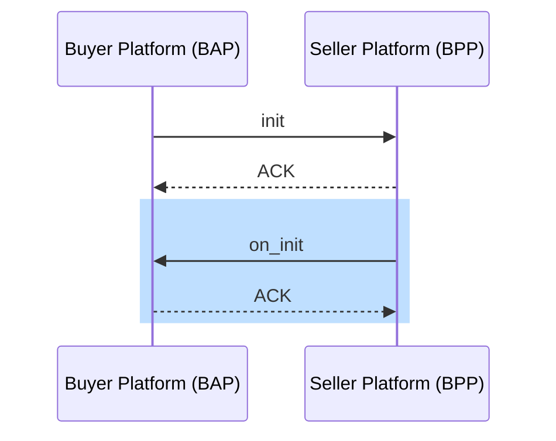
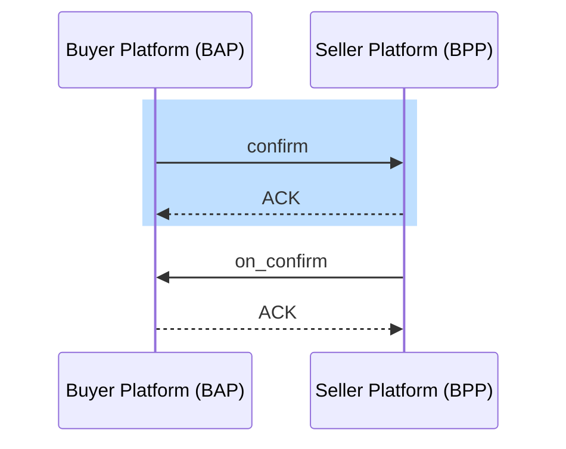
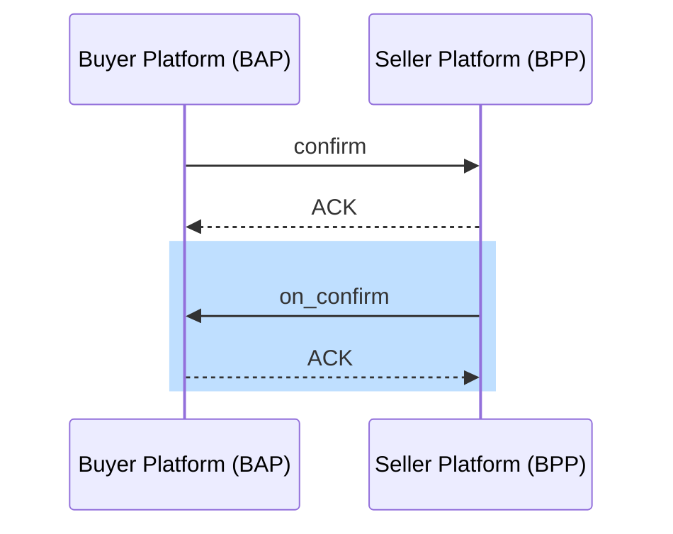
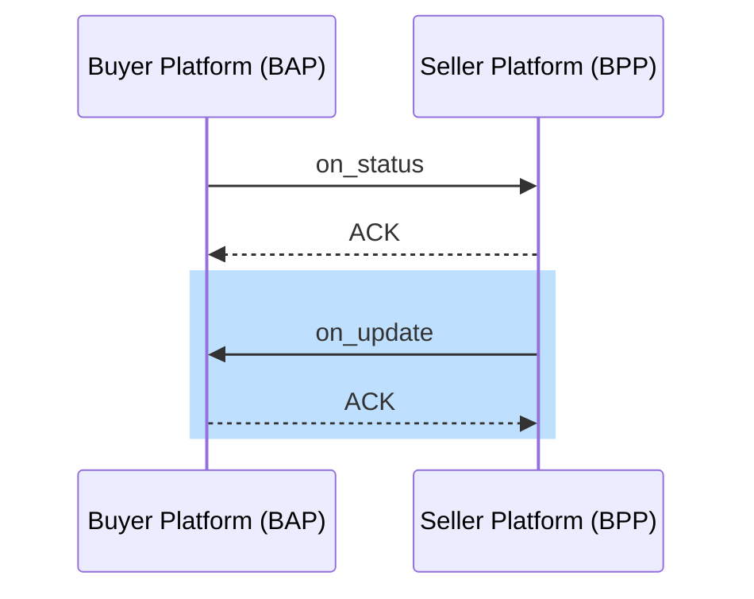

# Redemption By Amount — Sequence Diagrams

Internal data file consumed by the Developer Guide's "Sequence Diagram" tab (API Walkthrough).
Not meant to be shown as its own docs page — the frontend filters this slug out of the Use Case
Brief / Additional Resources / Changelog tab lists and instead looks up the section matching the
selected API call's `action_id` (the `##` heading below) to render that step's diagram.

One `## <action_id>` heading per step of `Redemption_By_Amount.yaml`, in that flow's own step order, each
followed by its Mermaid `sequenceDiagram`.

No dedicated source exists for this step; reuses the generic diagram already established for the same role (select/on_select/init/on_init/confirm/on_confirm/on_status/on_update) elsewhere in this domain's own source material.

## select_redemption

## on_select_redemption

## init_redemption

## on_init_redemption

## confirm_redemption

## on_confirm_redemption

## on_update_redemption

