# SIP Creation New Folio — Sequence Diagrams

Internal data file consumed by the Developer Guide's "Sequence Diagram" tab (API Walkthrough).
Not meant to be shown as its own docs page — the frontend filters this slug out of the Use Case
Brief / Additional Resources / Changelog tab lists and instead looks up the section matching the
selected API call's `action_id` (the `##` heading below) to render that step's diagram.

One `## <action_id>` heading per step of `SIP_Creation_New_Folio.yaml`, in that flow's own step order, each
followed by its Mermaid `sequenceDiagram`.

`payment_url_form` (and its equivalents) has no source anywhere in this domain's spec material either -- every source file's own "Payment" form step is itself blank. Reuses the generic payment-redirection diagram already authored for Personal Loan, adapted to this domain's own participant naming (Buyer Platform (BAP) / Seller Platform (BPP)).

## select

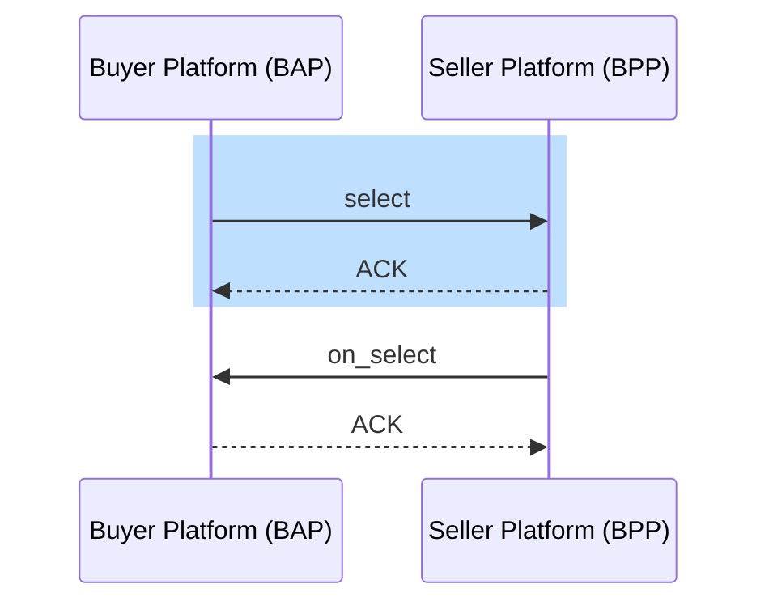

## on_select_1_new_folio

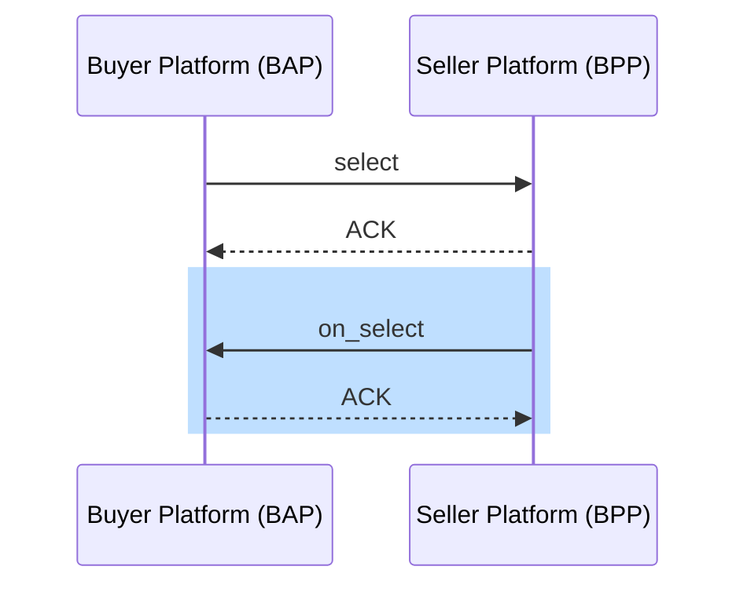

## investor_details_form

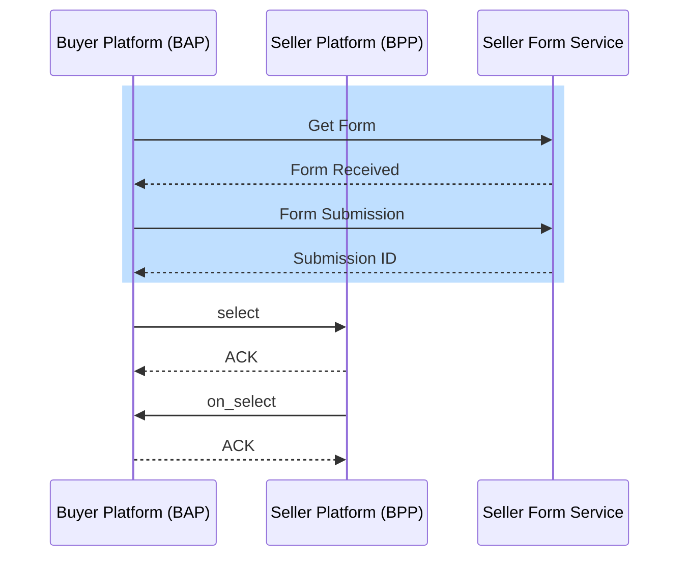

## select_2

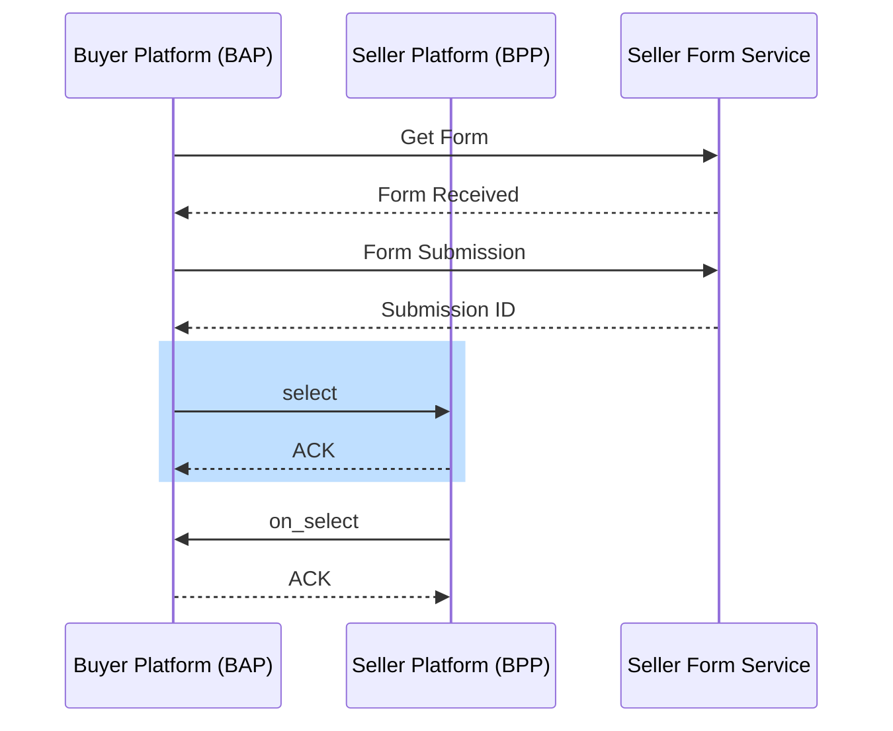

## on_select_2_new_folio

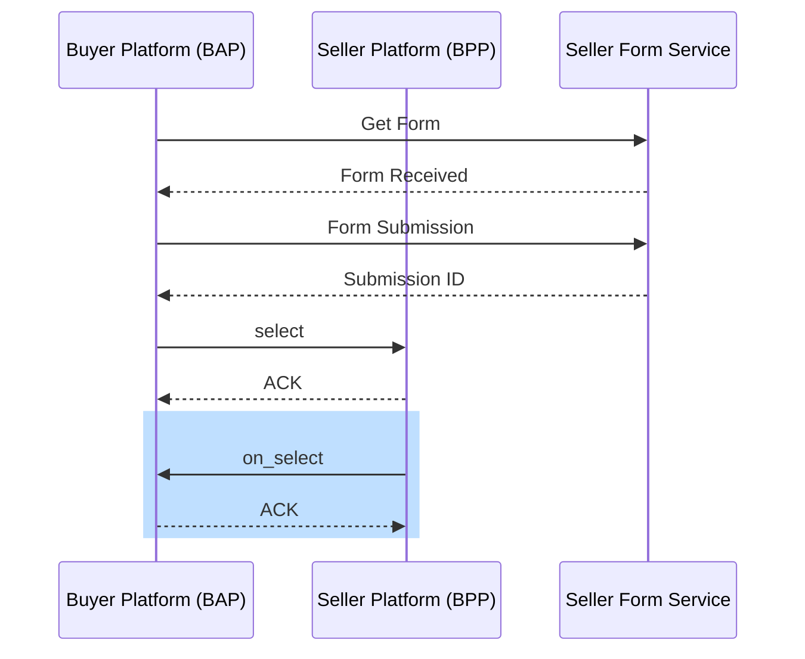

## init

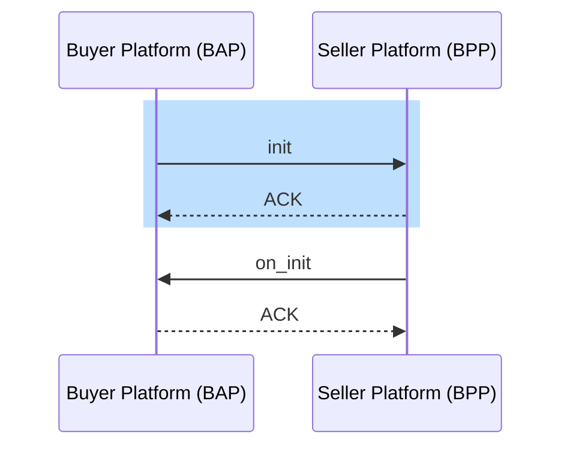

## on_init_new_folio

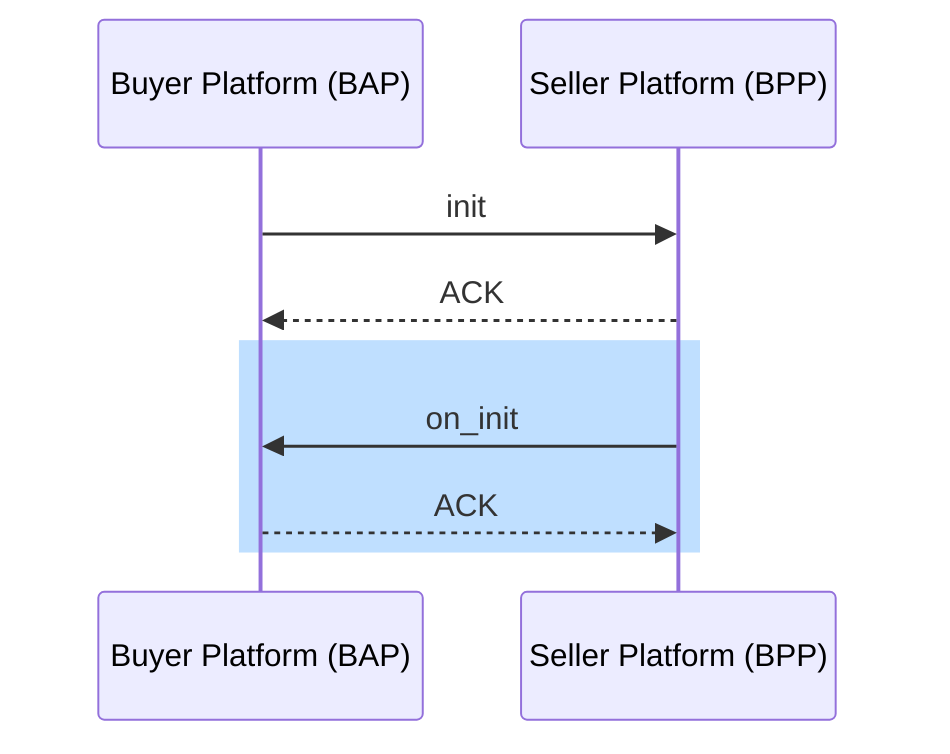

## confirm

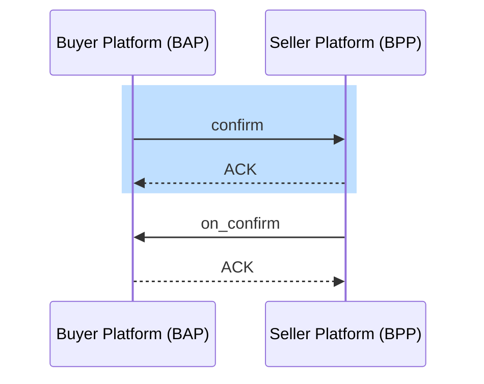

## on_confirm_new_folio

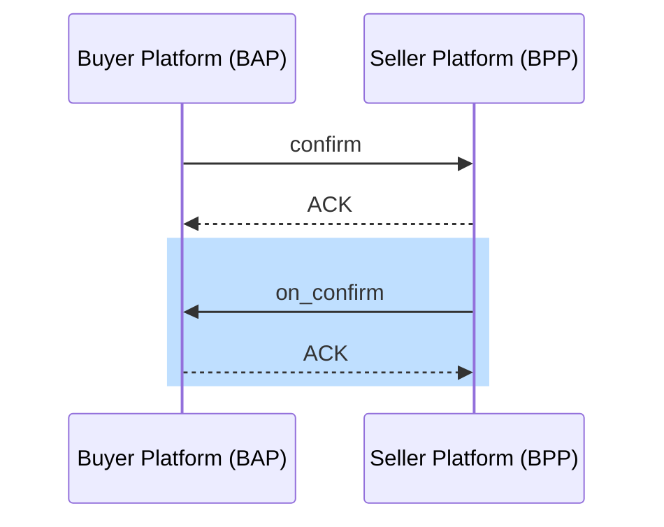

## payment_url_form

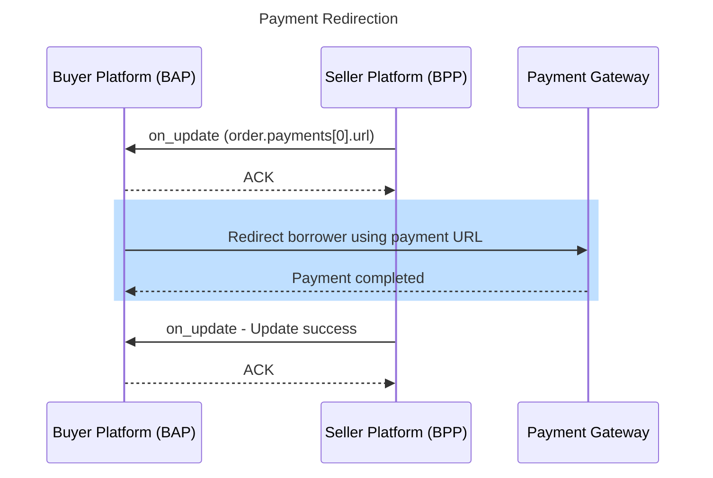

## on_status_unsolicited_new_folio_payment

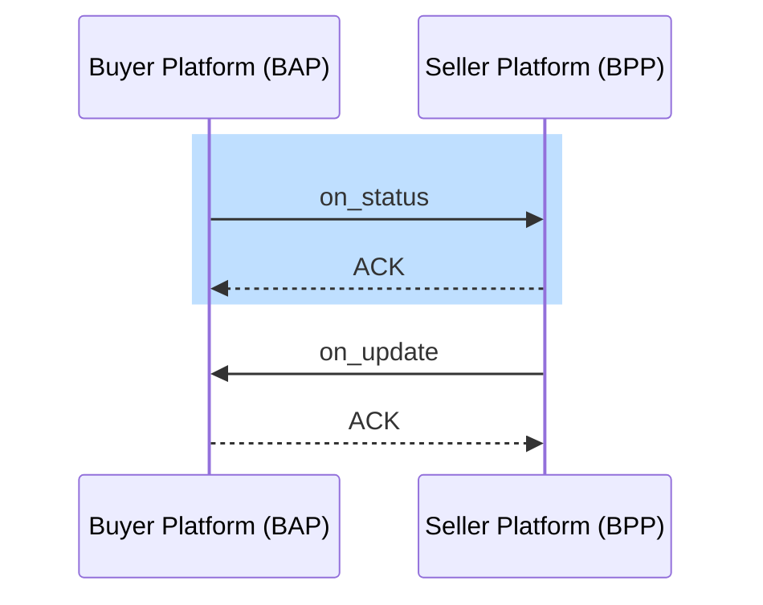

## on_update_unsolicited_new_folio

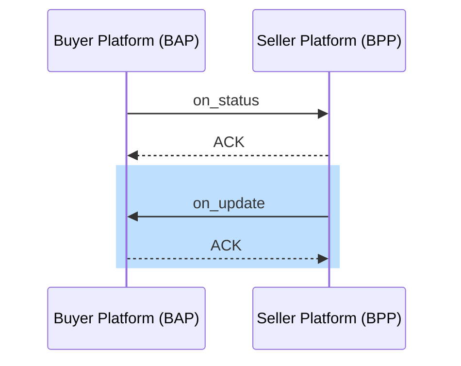
